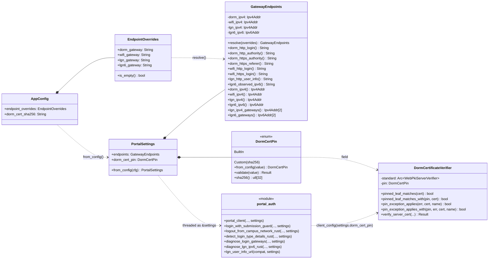
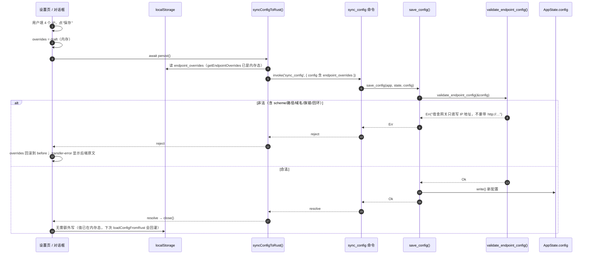
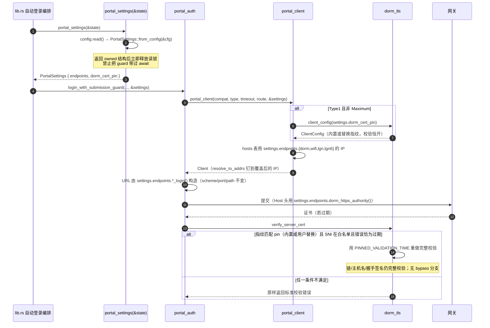
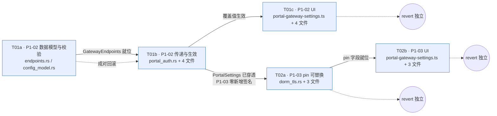

# 第二批增量开发设计（P1-02 端点覆盖配置 / P1-03 宿舍证书 pin 可维护化）

> 基线：分支 `feat/robustness-ipv6` @ `f8c1b6d`（第一批已完成，P1-01 = `80b1109`）
> 上游输入：`docs/development-backlog.md`（PM）、`docs/development-plan.md`（第一批设计）、team-lead 第二批需求说明
> 本文档只做设计，**不含任何源代码改动、不提交**。
> 所有行号、签名、计数均在 `f8c1b6d` 工作树上实测。

---

## 0. 结论摘要与需要拍板的事项

### 0.1 三个必须先看的发现

**发现 1（阻塞级，P1-03）：只替换指纹在技术上不完整。**
`dorm_tls.rs` 的 pin 例外不是"信任这张证书"，而是"**用 `PINNED_VALIDATION_TIME` 这个历史时间点重新做一次完整校验**"（`dorm_tls.rs:88-100`）。`PINNED_VALIDATION_TIME = 1_755_648_000` ≈ **2025-08-20**，落在内置证书有效期 2024-08-08～2025-09-09 内。

因此用户替换指纹后，只有当**新证书的有效期也覆盖 2025-08-20** 时例外才会生效。如果学校 2026 年换发一张 2026-09～2027-09 的证书：
- 若该证书**当前有效** → 标准 PKI 直接通过，**根本不需要 pin**（这是最可能的真实情况）；
- 若该证书**已过期** → 用 2025-08-20 重校验仍然失败，替换指纹无效。

→ **只做"替换指纹"无法覆盖"学校换发另一张过期证书"这一场景。** 三种处理方式见 §3.7，需要 lead 选一个。我推荐 **A（只做替换 + UI 明示限制）**，因为学校换发有效证书时 P1-03 本来就无事可做，而放宽时间点属于安全敏感变更，不该塞进"可维护性"任务。

**发现 2（P1-02 范围修正）：覆盖值不能是域名，只能是 IP。**
需求建议"只覆盖主机/IP"。实测结论：**必须收窄为"只覆盖 IP"**，理由三条（§2.1 详述）：
1. `portal_client` 的架构是"URL 里放校园域名（做 SNI/Host），再用 `resolve_to_addrs` 把该域名钉到已知 IP"（`portal_auth.rs:231-283`）。用户能改的、真正会变的是**被钉的 IP**，不是域名。
2. 域名绑在证书 SAN 上：把 `wlgn.bjut.edu.cn` 改成别的域名而证书没换，握手必然失败 —— 覆盖域名是纯粹的 footgun。
3. 域名同时是**宿舍 pin 例外的 SNI 白名单**（`TLS_HOST_CANDIDATES`，`endpoints.rs:57`）与 `probe_body_matches` 的指纹词（`portal_auth.rs:804` 的 `contains("lgn.bjut.edu.cn")`）。让用户改域名等于让用户改 SNI 白名单，会直接削弱 P1-03 的安全边界。

→ 校验规则里**域名被明确拒绝**，错误文案说明原因。若 lead 坚持支持域名，需追加约 3 倍工作量并重开 P1-03 的 SNI 白名单设计（§2.3 给出条件）。

**发现 3（P1-02 陷阱）：`syncConfigToRust()` 会静默清空新字段。**
前端不是"改一个字段推一个字段"，而是在 `src/main.ts:789` 的 `syncConfigToRust()` 里**逐字段手工重建整个 config 对象**再整体 `invoke('sync_config')`。任何一次设置变更（改主题、改检测间隔）都会用这个重建对象覆盖 Rust 侧配置。**如果新字段没有同步加进这个函数，用户保存的网关覆盖会在下一次任意设置变更时被清空**，而且不会有任何报错。

→ P1-02 的提交必须**同时**改：`config_model.rs`、`src/models.ts`、`loadConfigFromRust()`、`syncConfigToRust()`。四者缺一即数据丢失。这是本批最容易漏的地方。

### 0.2 PM 清单中与已确认决策冲突之处（以决策为准修正）

| PM 原文（P1-03 验收 1） | 冲突 | 修正 |
| --- | --- | --- |
| 「关闭 pin 例外后过期证书拒绝」 | 已确认决策是「**只允许替换指纹，不允许关闭校验**」。若真的提供"关闭例外"开关，就是提供了"关掉证书校验"的能力，与决策直接矛盾 | 删除该验收项。改为「**内置默认配置下，未匹配指纹的过期证书仍被拒绝**」——这已由现有测试 `a_different_expired_certificate_is_not_pinned` 覆盖，本批不新增该能力 |

| PM 原文（P1-02 验收 1） | 修正 |
| --- | --- |
| 「非法 **IP/域名** 被拒绝保存」 | 改为「非法 **IP** 被拒绝；**域名一律拒绝**（附原因文案）」 |

### 0.3 需要 lead 拍板的 3 件事

1. **P1-03 的时间点问题**（发现 1）：选 A（只替换指纹 + 明示限制）／B（追加"校验时间点"输入）／C（有界回溯扫描）。推荐 A，理由见 §3.7。
2. **P1-02b 的覆盖范围**：全量 4 个网关（约 24 个签名 + 15 个调用点）／只覆盖宿舍网关（约减半）。见 §2.4 末尾的对比表。
3. **`billing/transport.rs` 与 `diagnostic_tools.rs` 里的网关 IP**（第一批 P1-01 留下的 B 组）是否纳入本批。**我的建议是不纳入**，理由见 §8。

---

## 0.4 执行修正（2026-10-29）

- T01a/T01b 合并为一个后端提交：T01a 单独提交时 `GatewayEndpoints` 尚未被生产代码消费，`clippy --all-targets -D warnings` 会因 dead_code 变红。UI 仍单独提交。
- 前端 wire format 使用 snake_case（`dorm_gateway` 等），与既有 `BackendConfig` 风格一致；Rust serde 同时保留 camelCase 输入别名。设计稿 §2.5.3 的 `dormGateway` 仅作为输入别名，不作为序列化键。
- P1-03 采用方案 A（只替换指纹 + UI 明示限制），不提供“关闭校验”开关，也不增加校验时间点配置。

## 1. 现状核对（实测，作为设计前提）

### 1.1 端点常量现状

`src-tauri/src/portal_auth/endpoints.rs`（第一批新建，129 行）已集中全部登录端点常量，`mod tests` 里有 golden 快照测试 `endpoint_constants_are_the_captured_gateway_values`（第 64 行）。

4 个逻辑网关与它们的"拨号目标"：

| 逻辑网关 | 拨号目标（会被学校改动的东西） | 出现在 URL 里的形式 | 证书依赖 |
| --- | --- | --- | --- |
| 宿舍 bjut-sushe | `10.21.221.98`（IPv4） | **IP 直接进 URL**：`http://10.21.221.98:801/...`、`https://10.21.221.98:802/...`（`DORM_HTTP_LOGIN`/`DORM_HTTP_REFERER`/`DORM_HTTPS_REFERER`），另用 `DORM_HTTPS_AUTHORITY` 作 Host 头 | SNI = `wlgn/lgn.bjut.edu.cn`，走 `dorm_tls` 的过期 pin |
| Wi-Fi bjut_wifi | `10.21.251.3`（IPv4） | HTTP 变体 IP 进 URL；HTTPS 变体 URL 用 `wlgn.bjut.edu.cn` + `resolve_to_addrs` 钉到该 IP | 标准 PKI（证书 SAN 含 `wlgn.bjut.edu.cn`） |
| 有线 lgn | `172.30.201.2` + `172.30.201.10`（IPv4） | HTTP 变体 IP 进 URL（`LGN_HTTP_USER_INFO`）；HTTPS 变体用 `lgn.bjut.edu.cn` + 钉 IP | 标准 PKI |
| 有线 lgn6 | `2001:da8:216:30c9::2` + `::a`（IPv6） | 不适用（始终用 `lgn6.bjut.edu.cn`） | 标准 PKI |

**关键结构事实**：`portal_client`（`portal_auth.rs:191-285`）用一个 `hosts: Vec<(&str, Vec<IpAddr>)>` 表把"URL 里的主机名"映射到"要钉的 IP"（第 231-253 行），第 261-282 行对每个 `(host, addresses)` 调 `resolve_to_addrs`。**改 IP 是这张表的局部修改；改主机名会同时影响 SNI、Host 头、pin 白名单、响应指纹匹配**——这就是发现 2 的技术根据。

### 1.2 配置与持久化链路现状

| 环节 | 位置 | 现状 |
| --- | --- | --- |
| 配置结构 | `config_model.rs:69-147` `AppConfig` | 30 个字段；已有嵌套结构先例：`tray: TraySettings`（71 行）、`traffic_retention: Retention`（79 行）、`saved_router: Option<SavedRouter>`（82 行） |
| 保存校验 | `lib.rs:4157` `save_config()` | 逐项 normalize/validate，失败返回 `Err(String)`，前端原样展示 |
| 前端拉取 | `lib.rs:5491` `get_app_config` | 直接 `serde_json::to_value(&config)`，**新增字段自动出现在返回值里** |
| 前端推送 | `lib.rs:5452` `sync_config` → `save_config` | 前端整体覆盖 |
| 前端装载 | `src/main.ts:863` `loadConfigFromRust()` | 逐字段写 localStorage |
| 前端提交 | `src/main.ts:789` `syncConfigToRust()` | **逐字段手工重建 config 对象**（发现 3 的根源） |
| 备份导出 | `lib.rs:5362` `export_config_backup` → `merge_backup_config`（1547） | `scope.settings` 时**整结构复制**，新字段自动包含 |
| 备份导入 | `lib.rs:5416` `import_config_backup` | 先 `validate_imported_config`（3754，目前只校验 accounts/profiles/tray）再 `save_config` |
| TS 类型 | `src/models.ts:25` `BackendConfig` | 需同步加字段 |

### 1.3 UI 现状

| 事实 | 位置 | 影响 |
| --- | --- | --- |
| 高级设置分组存在且非 desktop-only | `index.html:1275` `<h3>高级设置</h3>` | 新行会同时出现在 Android |
| 已有"一行 + 按钮 + 弹窗"先例 | `index.html:1286` 菜单栏与托盘行 + `src/tray-preferences.ts` | **直接复用该模式**：1 行 HTML + 1 个 TS 模块 + `main.ts` 1 行注册 |
| `presentationDialog(id, title)` 提供 `{form, close}` | `src/presentation-dialog.ts:1-54` | 自带焦点管理、Esc、Tab 陷阱、动画 |
| 弹窗模块的持久化契约 | `main.ts:2066` `setupTrayPreferences(syncConfigToRust)` | 模块内先改内存、`await persist()`，失败回滚内存（`tray-preferences.ts:73-82`） |
| **托盘按钮行不在 `SETTINGS_COPY.items`** | `settings.ts` 无 `btn-tray-preferences` | 新行照此办理 → **不新增惰性 copy 条目**，也不影响第一批的 P1-05 首帧文案守卫 |
| `SETTINGS_COPY.items` 共 25 项 | `settings.ts` | P1-05 守卫要求：新增 key 必须在 `index.html` 有 `id="<key>"` |

### 1.4 证书 pin 现状

`src-tauri/src/portal_auth/dorm_tls.rs`：

| 行 | 内容 |
| --- | --- |
| 13 | `pub(super) use super::endpoints::TLS_HOST_CANDIDATES;`（SNI 白名单） |
| 18-21 | `const EXPIRED_DORM_CERT_SHA256: [u8; 32]`（内置指纹） |
| 26-27 | `const PINNED_VALIDATION_TIME: UnixTime = 1_755_648_000`（≈2025-08-20） |
| 30-32 | `struct DormCertificateVerifier { standard: Arc<WebPkiServerVerifier> }` |
| 35-38 | `fn pinned_leaf_matches(end_entity) -> bool`（关联函数，用内置常量） |
| 40-45 | `fn pinned_name_matches(server_name) -> bool`（SNI 白名单） |
| 47-54 | `fn is_expiry_error(error) -> bool` |
| 60-68 | `fn pin_exception_applies(error, end_entity, server_name) -> bool`（关联函数） |
| 72-103 | `verify_server_cert`：标准校验 → 若三条件满足则用 `PINNED_VALIDATION_TIME` 重校验 |
| 128-139 | `pub(super) fn client_config() -> Result<ClientConfig, String>` |
| 141-301 | 9 个测试（**断言一行都不能改**） |

**唯一生产调用点**：`portal_auth.rs:208` `.use_preconfigured_tls(dorm_tls::client_config()?)`，在 `portal_client` 内、`LoginType::Type1 && compatibility != Maximum` 分支。
（`probe_transport.rs:133/401` 有同名但独立的 `client_config`，与本项无关。）

**现有测试对签名的耦合（决定改动方式的关键）**：
- `pinned_leaf_matches(&cert)` 被 `captured_gateway_certificate_matches_the_embedded_pin`（170-175）、`a_different_expired_certificate_is_not_pinned`（232-245）调用 —— **关联函数形式**。
- `pin_exception_applies(&err, &cert, &name)` 被 3 个测试调用 —— **关联函数形式**。
- `verifier_pair()`（181-194）用**结构体字面量** `DormCertificateVerifier { standard: standard.clone() }` 构造 —— **加字段必然要改这一行**。

→ 设计约束：**保留这两个关联函数的原签名**（内部固定用内置指纹），另加 `_with` 变体给 verifier 用。这样 9 个现有测试的**断言零改动**，只有 `verifier_pair()` 里 1 行结构体字面量必须补字段。

---

## 2. P1-02 端点覆盖配置

### 2.1 数据模型：为什么只覆盖 IP

**覆盖单位 = 4 个逻辑网关各一个"拨号 IP"**，不覆盖 scheme / host / port / path。

| 网关 | 字段 | 默认值 | 地址族 |
| --- | --- | --- | --- |
| 宿舍 bjut-sushe | `dorm_gateway` | `10.21.221.98` | IPv4（强制） |
| Wi-Fi bjut_wifi | `wifi_gateway` | `10.21.251.3` | IPv4（强制） |
| 有线 lgn | `lgn_gateway` | `172.30.201.2` | IPv4（强制） |
| 有线 lgn6 | `lgn6_gateway` | `2001:da8:216:30c9::2` | IPv6（强制） |

**为什么不覆盖 scheme / path / port**（PM 已建议，这里补技术理由）：
1. **port 与 scheme 是协议契约**：`10.21.221.98:801` 是 ePortal HTTP、`:802` 是 ePortal HTTPS、`lgn.bjut.edu.cn:802` 是有线 ePortal。它们是抓包验证过的固定值（见 `docs/lgn-authentication.md`）。让用户改端口等于允许把登录报文发到错误的服务，只会产生"看起来在登录但永远失败"的状态。
2. **path 决定协议语义**：`/eportal/portal/login`、`/drcom/chkstatus`、`/drcom/getipv6` 分别对应三套完全不同的报文格式。改 path 会直接破坏 `parse_dr_response` / `parse_observed_ip` 的解析前提。
3. **scheme 是安全属性**：HTTPS→HTTP 降级是安全回退，不能由用户配置项随手触发。
4. **`VpnCompatibility` 已经管 scheme**：`Maximum` 模式本来就会把 HTTPS 换成 HTTP 直连（`portal_auth.rs:448-452`、`1331-1335`、`1346-1350`）。再加一个 scheme 开关就是两个开关管同一件事，必然冲突。

**为什么不覆盖域名**（发现 2，三条理由见 §0.1）。

**为什么不覆盖 lgn 的第二个 IPv4（`172.30.201.10`）与 lgn6 的第二个 IPv6（`::a`）**：这两个是**同一网关的备用地址**，代码里是"主地址 + 备地址"成对使用（`portal_auth.rs:239-251`、`398-405`）。v1 只让用户改主地址，备地址跟随主地址所在网段推导会引入不可预期的行为；保持备地址为内置值，语义最简单：**"主地址优先，内置备地址兜底"**。若用户的新网关没有备地址，行为等价于单地址（探测失败即回退），无副作用。

### 2.2 配置字段与兼容性

`src-tauri/src/config_model.rs`：

```rust
/// 用户可覆盖的校园网网关地址。空字符串 = 使用内置值。
/// 只允许 IP 字面量：scheme / 端口 / 路径由协议契约固定，域名绑定证书 SAN。
#[derive(serde::Serialize, serde::Deserialize, Clone, Debug, Default, PartialEq, Eq)]
pub(crate) struct EndpointOverrides {
    #[serde(default, alias = "dormGateway")]
    pub(crate) dorm_gateway: String,
    #[serde(default, alias = "wifiGateway")]
    pub(crate) wifi_gateway: String,
    #[serde(default, alias = "lgnGateway")]
    pub(crate) lgn_gateway: String,
    #[serde(default, alias = "lgn6Gateway")]
    pub(crate) lgn6_gateway: String,
}

impl EndpointOverrides {
    pub(crate) fn is_empty(&self) -> bool {
        self.dorm_gateway.is_empty()
            && self.wifi_gateway.is_empty()
            && self.lgn_gateway.is_empty()
            && self.lgn6_gateway.is_empty()
    }
}
```

`AppConfig` 增加 2 个字段（放在 `vpn_maximum_until` 之后，靠近网络相关配置）：

```rust
    /// 网关地址覆盖。缺省/全空 = 完全使用内置值，行为与之前逐字节一致。
    #[serde(default, skip_serializing_if = "EndpointOverrides::is_empty")]
    pub(crate) endpoint_overrides: EndpointOverrides,
    /// 宿舍网关证书指纹覆盖（64 位十六进制，可带冒号）。空 = 使用内置指纹。
    /// 只能替换指纹，不能关闭 pin 例外。
    #[serde(default, skip_serializing_if = "String::is_empty")]
    pub(crate) dorm_cert_sha256: String,
```

**兼容性影响**

| 场景 | 行为 |
| --- | --- |
| 旧配置文件（无这两个字段） | `#[serde(default)]` → `EndpointOverrides::default()`（全空）+ `""` → 解析为内置值 → **行为与当前完全一致** |
| 旧前端（不带这两个字段调 `sync_config`） | 同上 → 内置值。**这是安全方向**：字段缺失 = 不覆盖 |
| 新配置写盘后回旧版本 App | 旧版 `AppConfig` 无该字段，`serde` 默认忽略未知字段（未启用 `deny_unknown_fields`）→ 正常加载，覆盖值被忽略但**不丢盘**（旧版保存时会丢掉，属预期降级） |
| 序列化 | `skip_serializing_if` 让默认配置的 JSON 与改动前**逐字节一致**，不污染备份文件 |

> 命名说明：Rust 侧 `snake_case` + `alias` 驼峰，与 `auto_login`/`check_interval` 等既有 30 个字段风格一致。备份 JSON 用 `snake_case`（`AppConfig` 未加 `rename_all`），与既有备份格式一致。

### 2.3 校验规则

校验函数放在 `endpoints.rs`（纯函数，无 IO、无锁），在 **`save_config` 与 `validate_imported_config` 两处调用**：

```rust
/// 校验并规范化网关覆盖。返回 Err 时整次保存被拒绝。
pub(crate) fn validate_endpoint_overrides(overrides: &EndpointOverrides) -> Result<(), String> {
    validate_gateway("宿舍网关", &overrides.dorm_gateway, AddressFamily::V4)?;
    validate_gateway("Wi-Fi 网关", &overrides.wifi_gateway, AddressFamily::V4)?;
    validate_gateway("有线网关", &overrides.lgn_gateway, AddressFamily::V4)?;
    validate_gateway("有线 IPv6 网关", &overrides.lgn6_gateway, AddressFamily::V6)
}
```

规则（按顺序，命中即返回）：

| # | 规则 | 错误文案 |
| --- | --- | --- |
| 1 | 空 → 合法（用内置值），直接返回 Ok | — |
| 2 | `value.trim() != value`（前后有空白） | `{label}地址前后不能有空格` |
| 3 | 含 `://` | `{label}只填写 IP 地址，不要带 http:// 或 https://` |
| 4 | 含 `/` `?` `#` | `{label}只填写 IP 地址，不要带路径或查询参数` |
| 5 | 含 `@` | `{label}不能包含账号或密码` |
| 6 | 含 `:` 但 `parse::<IpAddr>()` 失败（IPv4 场景）或含非十六进制冒号分组（IPv6 场景） | 落到 #7/#8 的族错误 |
| 7 | `parse::<IpAddr>()` 失败 | `{label}不是合法的 IP 地址` |
| 8 | 族不符（dorm/wifi/lgn 要求 V4，lgn6 要求 V6） | `{label}必须是 IPv4 地址` / `{label}必须是 IPv6 地址` |
| 9 | `is_unspecified()` / `is_loopback()` / `is_multicast()` | `{label}不能是未指定、回环或组播地址` |
| 10 | IPv4 `is_broadcast()` / `is_link_local()`（169.254/16） | 同上 |
| 11 | IPv6 `is_unicast_link_local()` / `to_ipv4_mapped().is_some()` | 同上（与 `portal_auth.rs:935-944` 的 `parse_observed_ip` 检查保持一致） |
| 12 | 域名（`parse::<IpAddr>()` 失败且含字母） | `{label}必须填写 IP 地址：域名与证书绑定，不接受修改` |

**关于 #12 的取舍**：错误文案必须解释"为什么不能填域名"，否则用户会反复尝试。文案里同时给出行动指引（"请从网络管理员处获取新网关的 IP"）。

**不校验"是否校园网段"**：校园地址可能是 `10/8`、`172.30/16`、`2001:da8::/32`（全球单播），无法用网段白名单表达。安全性由"只允许 IP + UI 二次确认 + 启动审计日志"承担（§2.7）。

**规范化**：通过校验后统一 `trim()` + IPv6 用 `IpAddr::to_string()` 规范化（小写、压缩零），避免同一地址两种写法导致 `PartialEq` 不等。规范化在 `GatewayEndpoints::resolve` 里做，**不回写用户输入**（保留用户原文，只在解析时规范化）。

### 2.4 从 AppState 传到 portal_auth（避免全局可变状态）

**原则**：配置只在**操作边界**读一次，解析成一个 owned 的、`Copy`-友好（实际用 `Clone`）的小结构，之后按值/按引用往下传。**不引入 `static`/`thread_local`/`OnceLock`，不在 `.await` 期间持有配置锁**。

#### 2.4.1 新增两个类型（`endpoints.rs`）

```rust
/// 解析后的有效网关地址。构造后不可变，可安全跨 await 传递。
#[derive(Clone, Debug, PartialEq, Eq)]
pub(crate) struct GatewayEndpoints {
    dorm_ipv4: Ipv4Addr,
    wifi_ipv4: Ipv4Addr,
    lgn_ipv4: Ipv4Addr,
    lgn6_ipv6: Ipv6Addr,
}

impl Default for GatewayEndpoints {
    fn default() -> Self {
        Self::resolve(&EndpointOverrides::default())
    }
}

impl GatewayEndpoints {
    /// 纯函数：把覆盖值叠到内置值上。非法值静默回落到内置值
    /// （保存时已拒绝，这里是导入/旧数据的防御层）。
    pub(crate) fn resolve(overrides: &EndpointOverrides) -> Self;

    // 以下访问器返回与第一批常量逐字节相同的字符串，
    // 因此调用点只需把 `DORM_HTTP_LOGIN` 换成 `endpoints.dorm_http_login()`。
    pub(crate) fn dorm_http_login(&self) -> String;        // http://{dorm}:801/eportal/portal/login
    pub(crate) fn dorm_http_authority(&self) -> String;    // {dorm}:801
    pub(crate) fn dorm_http_referer(&self) -> String;      // http://{dorm}/
    pub(crate) fn dorm_https_authority(&self) -> String;   // {dorm}:802
    pub(crate) fn dorm_https_referer(&self) -> String;     // https://{dorm}:802/
    pub(crate) fn wifi_http_login(&self) -> String;
    pub(crate) fn wifi_http_logout(&self) -> String;
    pub(crate) fn wifi_http_chkstatus(&self) -> String;
    pub(crate) fn wifi_http_referer(&self) -> String;
    pub(crate) fn wifi_https_login(&self) -> String;
    pub(crate) fn wifi_https_logout(&self) -> String;
    pub(crate) fn wifi_https_chkstatus(&self) -> String;
    pub(crate) fn wifi_https_referer(&self) -> String;
    pub(crate) fn lgn_http_user_info(&self) -> String;     // http://{lgn}:801/...
    pub(crate) fn lgn_https_authority(&self) -> String;    // {lgn}:802
    pub(crate) fn lgn6_observed_ipv6(&self) -> String;

    // 拨号地址（给 resolve_to_addrs 与 local_address 用）
    pub(crate) fn dorm_ipv4(&self) -> Ipv4Addr;
    pub(crate) fn wifi_ipv4(&self) -> Ipv4Addr;
    pub(crate) fn lgn_ipv4(&self) -> Ipv4Addr;
    pub(crate) fn lgn6_ipv6(&self) -> Ipv6Addr;
    /// lgn 的两个 IPv4：主地址用覆盖值，备地址保持内置值（§2.1 末段）。
    pub(crate) fn lgn_ipv4_gateways(&self) -> [Ipv4Addr; 2];
    /// lgn6 的两个 IPv6：主地址用覆盖值，备地址保持内置值。
    pub(crate) fn lgn6_gateways(&self) -> [Ipv6Addr; 2];
}
```

> **`lgn_https_login` / `lgn_https_logout` / `lgn_https_user_info` 不需要覆盖**：它们的 URL 主机是 `lgn.bjut.edu.cn`（域名），IP 通过 `resolve_to_addrs` 钉住。因此这三个访问器保持返回 `endpoints::LGN_HTTPS_*` 常量原值即可 —— 覆盖生效靠 `lgn_ipv4()` 改钉表，不改 URL。这正是 §2.1 结论的直接体现。

#### 2.4.2 `PortalSettings`（`portal_auth.rs` 顶部）

为避免 `portal_client` 同时收两个新参数（P1-03 还要加 pin），统一收成一个：

```rust
/// 一次操作所需的全部校园网配置快照。在操作边界解析一次，之后只读。
#[derive(Clone, Debug, Default, PartialEq, Eq)]
pub(crate) struct PortalSettings {
    pub(crate) endpoints: GatewayEndpoints,
    pub(crate) dorm_cert_pin: dorm_tls::DormCertPin,
}

impl PortalSettings {
    pub(crate) fn from_config(config: &crate::config_model::AppConfig) -> Self {
        Self {
            endpoints: GatewayEndpoints::resolve(&config.endpoint_overrides),
            dorm_cert_pin: dorm_tls::DormCertPin::from_config(&config.dorm_cert_sha256),
        }
    }
}
```

`PortalSettings::default()` = 全内置值 → 测试与无配置路径零成本。

#### 2.4.3 边界解析（`lib.rs` 一个辅助函数）

```rust
/// 在操作边界解析一次；调用方必须在本函数返回后即释放配置读锁，
/// 不得跨 await 持有。
fn portal_settings(state: &AppState) -> portal_auth::PortalSettings {
    let config = state.config.read().unwrap();
    portal_auth::PortalSettings::from_config(&config)
}
```

不用 `impl AppState` 方法：当前 `lib.rs` 没有 `impl AppState` 块，加自由函数 diff 更小。

#### 2.4.4 签名变更表（24 处，全部是"加一个末尾参数"）

`src-tauri/src/portal_auth.rs`：

| 行 | 现签名 | 改为 | 内部要改的行 |
| --- | --- | --- | --- |
| 191 | `portal_client(compatibility, login_type, timeout, route_context)` | `+ settings: &PortalSettings` | 208 `client_config()`（P1-03）、235 `DORM_GATEWAY_IPV4`、238 `WIFI_GATEWAY_IPV4`、243-249 `LGN_IPV4_GATEWAYS`/`LGN6_GATEWAY_IPV6` |
| 288 | `bind_lgn_ipv6_route(builder, route_context)`（`#[cfg(test)]`） | `+ settings` | 292 `LGN6_GATEWAY_IPV6[0]` |
| 327 | `lgn_ipv6_client(compatibility, timeout, route_context)` | `+ settings` | 340 转调 |
| 335 | `lgn_ipv6_client_for(compatibility, timeout, route_context, destination, native_tls)` | `+ settings` | 363 `LGN6_GATEWAY_IPV6[0]`、369 `LGN6_GATEWAY_IPV6` |
| 368 | `portal_probe_urls(compatibility, login_type)` | `+ settings` | 372 转调 |
| 375 | `portal_probe_urls_for_route(compatibility, login_type, physical_ipv4)` | `+ settings` | 387 `DORM_HTTP_LOGIN`、397 `type2_probe_url`、399/409 `lgn_user_info_url`、401-404 `LGN_IPV4_GATEWAYS`、409 `lgn_observed_ipv6_url` |
| 447 | `type2_probe_url(compatibility)` | `+ settings` | 449/451 `WIFI_HTTP_CHKSTATUS`/`WIFI_HTTPS_CHKSTATUS` |
| 462 | `login_readiness_probe_urls(compatibility, login_type, route_context)` | `+ settings` | 467 转调、480 `LGN_ROOT`/`LGN6_ROOT`、483 比较、486 `lgn_observed_ipv6_url` |
| 595 | `probe_login_type(compatibility, login_type, route_context)` | `+ settings` | 600/607/611/612/615/623 |
| 628 | `probe_primary_portal(compatibility, login_type, route_context)` | `+ settings` | 639 `portal_client`、650-654 referer、657 转调、659 `LGN6_HOST`（不变）、663 `DORM_HTTPS_AUTHORITY` |
| 714 | `probe_type1_http_portal_only(compatibility, login_type, route_context)` | `+ settings` | 726 `portal_client`、736-737 `DORM_HTTP_LOGIN`、743 `DORM_HTTP_REFERER` |
| 820 | `detect_login_type_details_rust(compatibility, ssid, transport, route_context)` | `+ settings` | 828 转调 |
| 832 | `diagnose_login_gateways(compatibility, ssid, transport, route_context)` | `+ settings` | 848 转调 |
| 944 | `lgn_observed_ipv6_url()` | `+ settings` | 945 `LGN6_OBSERVED_IPV6` |
| 956 | `lgn_login_url(user, pass, local_ipv4, observed_ipv6)` | `+ settings` | 962 `LGN_HTTPS_LOGIN`（返回常量，`&settings` 仅为签名一致） |
| 1000 | `lgn_logout_url(local_ipv4, observed_ipv6)` | `+ settings` | 1001 同上 |
| 1032 | `lgn_user_info_url(compatibility)` | `+ settings` | 1039/1041 `LGN_HTTP_USER_INFO`/`LGN_HTTPS_USER_INFO` |
| 1075 | `login_lgn_once(eportal_client, user, pass, compatibility, route_context, before_submit)` | `+ settings` | 1083 `LGN_HTTPS_AUTHORITY`、1088 转调、1096 `lgn_login_url`、1100 `LGN_REFERER`（不变） |
| 1115 | `discover_lgn_ipv6(compatibility, timeout, route_context)` | `+ settings` | 1123 `LGN6_GATEWAY_IPV6`、1146-1152 `lgn_ipv6_client_for` |
| 1178 | `diagnose_lgn_ipv6_rust(compatibility, route_context)` | `+ settings` | 1186 转调 |
| 1330 | `type2_logout_url(compatibility)` | `+ settings` | 1331/1333 `WIFI_HTTP_LOGOUT`/`WIFI_HTTPS_LOGOUT` |
| 1345 | `type2_login_url(compatibility, user, pass)` | `+ settings` | 1346/1348 `WIFI_HTTP_LOGIN`/`WIFI_HTTPS_LOGIN` |
| 1421 | `select_type1_tls_host(client, route_context)` | `+ settings` | 1429 `DORM_HTTPS_REFERER`、1434 `DORM_HTTPS_AUTHORITY` |
| 1455 | `login_to_campus_network_rust(login_type, user, pass, compatibility, route_context)` | `+ settings` | 1462 转调 |
| 1473 | `login_with_submission_guard(..., before_submit)` | `+ settings` | 1489 `portal_client`、1498-1502、1507-1508、1517、1521、1523、1538-1541、1546、1555 |
| 1569 | `logout_from_campus_network_rust(..., route_context)` | `+ settings` | 1582 `portal_client`、1597-1601、1605、1607、1610-1611、1625-1628、1632、1641、1643、1655 |

**不变**（URL 由调用方传入，不含端点）：`type1_https_login_base(host)`（418）、`type1_probe_url(login_base, physical_ipv4)`（422）、`type1_login_url(login_base, ...)`（1265）、`type1_logout_url(login_base, ...)`（1298）、`bind_lgn_ipv6_route_for(..., destination)`（295）、`probe_portal_urls`（667）、`get_jsonp_login`（1391）、`finish_portal_probes`（568）、`parse_*`/`eportal_encrypt`/`classify_*`。

#### 2.4.5 外部调用点（15 处，全部已有 `state` 或 `config`）

| 位置 | 现状 | 改为 |
| --- | --- | --- |
| `lib.rs:2447` `login_to_campus_network_rust` | 有 `config: AppConfig`（`run_headless_network_check` 入参） | `let settings = PortalSettings::from_config(&config);` + `&settings` |
| `lib.rs:5123` 同上 | 有 `state` | `let settings = portal_settings(&state);` + `&settings` |
| `lib.rs:8180` 同上 | 有 `state` | 同上 |
| `lib.rs:6786` `login_with_submission_guard` | 有 `state` | 同上 |
| `lib.rs:6182` `logout_from_campus_network_rust` | 有 `state` | 同上 |
| `lib.rs:2290` `detect_login_type_details_rust` | 有 `config` | `PortalSettings::from_config(&config)` |
| `lib.rs:4746` 同上 | 有 `state` | `portal_settings(&state)` |
| `lib.rs:5993` 同上 | 有 `state` | 同上 |
| `lib.rs:6337` 同上 | 有 `state` | 同上 |
| `lib.rs:6533` 同上 | 有 `state` | 同上 |
| `lib.rs:8047` 同上 | 有 `state` | 同上 |
| `lib.rs:2641` `portal_client` | **无 state**（`fetch_portal_user_info`） | 见下 |
| `lib.rs:2649` `lgn_user_info_url` | 同上 | 同上 |
| `lib.rs:5759` `diagnose_lgn_ipv6_rust` | 有 `state` | `portal_settings(&state)` |
| `network_diagnostics.rs:367` `diagnose_login_gateways` | 有 `app`（`try_state`） | `let settings = app.try_state::<Arc<AppState>>().map(\|s\| portal_settings(&s)).unwrap_or_default();` |
| `network_diagnostics.rs:376` `diagnose_lgn_ipv6_rust` | 同上 | 复用同一个 `settings` |

**`fetch_portal_user_info`（`lib.rs:2632`）**：本身没有 state，需加 `settings: &PortalSettings` 参数；它只有 **2 个调用方**，都持有 state：
- `connectivity.rs:358`（`observe()` 内，已有 `state`）→ 在 spawn 之前 `let settings = crate::portal_settings(state);` 再 move 进闭包
- `lib.rs:7494`（`get_user_info` 命令，已有 `state`）→ `portal_settings(&state)`

> **锁安全**：`portal_settings(&state)` 内部 `read()` 后立即返回 owned 结构，guard 在函数返回时释放。**禁止**写成 `let settings = &state.config.read().unwrap().endpoint_overrides;` 这类把 guard 带过 `.await` 的写法（会让任何 `save_config` 的 `write()` 永久阻塞）。

#### 2.4.6 覆盖范围对比（拍板项 2）

| 方案 | 覆盖网关 | portal_auth 签名改动 | 外部调用点 | 估计 diff | 价值 |
| --- | --- | --- | --- | --- | --- |
| **A 全量**（推荐） | dorm / wifi / lgn / lgn6 | 24 处 | 15 处 | ~150 行（含 `endpoints.` 前缀替换） | 完整满足"学校换地址"需求 |
| **B 仅宿舍** | dorm | ~8 处（`portal_client`、`probe_primary_portal`、`probe_type1_http_portal_only`、`login_readiness_probe_urls`、`portal_probe_urls_for_route`、`select_type1_tls_host`、`login_with_submission_guard`、`logout_*`） | 同上 15 处（入口签名统一） | ~80 行 | 只解决宿舍网（证书已过期的那一套），Wi-Fi/有线换地址仍需发版 |

推荐 A：入口签名反正要统一改，A 与 B 的外部调用点完全相同，**增量只在 portal_auth 内部 16 个函数的转发**，边际成本远小于"再发一版"的成本。

### 2.5 UI 最小改动

**沿用"菜单栏与托盘"模式**（`index.html:1286` + `src/tray-preferences.ts` + `main.ts:2066`），不新增惰性 copy 条目。

#### 2.5.1 `index.html`：高级设置组内新增 1 行（放在"更多控制台选项"之前）

```html
<div class="setting-item">
  <div class="setting-info">
    <h4>校园网网关地址</h4>
    <p>学校更换网关 IP 后无需等待新版本；留空即使用内置地址。</p>
  </div>
  <button class="btn btn-secondary btn-sm" id="btn-gateway-overrides" type="button">自定义</button>
</div>
```

> 注意：`id` 加在 **button** 上，与托盘行一致 → 第一批 P1-05 的守卫对 `<button>` 跳过标题断言，**不触发误报**。也**不**把该 key 加进 `SETTINGS_COPY.items`（避免新增惰性条目）。

#### 2.5.2 新增 `src/portal-gateway-settings.ts`（同时承载 P1-03 的指纹行）

```ts
import { presentationDialog } from './presentation-dialog';

export interface EndpointOverrides {
  dormGateway: string; wifiGateway: string; lgnGateway: string; lgn6Gateway: string;
}
export interface DormCertPinSettings { dormCertSha256: string }

const EMPTY_OVERRIDES = (): EndpointOverrides =>
  ({ dormGateway: '', wifiGateway: '', lgnGateway: '', lgn6Gateway: '' });

let overrides = EMPTY_OVERRIDES();
let certPin = '';

export function getEndpointOverrides(): EndpointOverrides { return { ...overrides }; }
export function loadEndpointOverrides(input?: Partial<EndpointOverrides>) {
  overrides = { ...EMPTY_OVERRIDES(), ...input };
}
export function getDormCertSha256(): string { return certPin; }
export function loadDormCertSha256(value?: string) { certPin = value ?? ''; }

/** 注册"校园网网关地址"行。persist 由 main.ts 注入 syncConfigToRust。 */
export function setupGatewayOverrides(persist: () => Promise<void>) { /* 见下 */ }
```

`setupGatewayOverrides` 的对话框内容（4 个 `type="text"` 输入 + 说明 + 重置按钮）：

```ts
document.getElementById('btn-gateway-overrides')?.addEventListener('click', () => {
  const draft = getEndpointOverrides();
  const { form, close } = presentationDialog('gateway-overrides-dialog', '校园网网关地址');
  const content = document.createElement('div');
  content.innerHTML = `
    <label class="form-group">宿舍网网关（bjut-sushe）<input name="dormGateway" placeholder="10.21.221.98"></label>
    <label class="form-group">Wi-Fi 网关（bjut_wifi）<input name="wifiGateway" placeholder="10.21.251.3"></label>
    <label class="form-group">有线网关（lgn）<input name="lgnGateway" placeholder="172.30.201.2"></label>
    <label class="form-group">有线 IPv6 网关（lgn6）<input name="lgn6Gateway" placeholder="2001:da8:216:30c9::2"></label>
    <p class="transfer-note">只填写 IP 地址：协议、端口与路径由认证协议固定；域名与证书绑定，不接受修改。留空表示使用内置地址。</p>
    <p class="transfer-error" role="alert"></p>
    <div class="modal-actions">
      <button type="button" class="btn btn-secondary" data-reset>恢复内置地址</button>
      <button type="button" class="btn btn-secondary" data-cancel>取消</button>
      <button class="btn btn-primary" type="submit">保存</button>
    </div>`;
  form.append(content);
  // 预填 draft，绑定 data-cancel / data-reset / submit
  // submit: 读 4 个输入 → 赋值 draft → 交换 overrides → await persist() → 失败则回滚 overrides 并显示 .transfer-error
});
```

**关键交互**：
- `data-reset` 把 4 个输入清空（不是直接保存），用户仍需点"保存"才生效 → 可取消。
- 提交失败（Rust 返回 `Err`）→ `.transfer-error` 显示后端原文（中文、已含具体网关名与原因），`overrides` 回滚到提交前 → 与托盘模式一致（`tray-preferences.ts:73-82`）。
- 对话框里**不复制任何校验逻辑**：唯一事实源是 Rust 的 `validate_endpoint_overrides`，避免两套规则漂移。

#### 2.5.3 `src/models.ts`：`BackendConfig` 加 2 个可选字段

```ts
  endpoint_overrides?: { dormGateway?: string; wifiGateway?: string; lgnGateway?: string; lgn6Gateway?: string };
  dorm_cert_sha256?: string;
```

#### 2.5.4 `src/main.ts`：4 处改动（发现 3 的落点）

| 位置 | 改动 |
| --- | --- |
| 文件顶部 import | `import { loadEndpointOverrides, loadDormCertSha256, getEndpointOverrides, getDormCertSha256, setupGatewayOverrides, setupDormCertPin } from './portal-gateway-settings';` |
| `syncConfigToRust()`（789-830 的 config 对象） | 加 2 行：`endpoint_overrides: getEndpointOverrides(),` 与 `dorm_cert_sha256: getDormCertSha256(),` |
| `loadConfigFromRust()`（863 起） | 加 2 行：`loadEndpointOverrides(config.endpoint_overrides); loadDormCertSha256(config.dorm_cert_sha256);` |
| 初始化区（2066 附近） | 加 1 行：`setupGatewayOverrides(syncConfigToRust); setupDormCertPin(syncConfigToRust);` |

> **不需要改**：`configBackupUiPreferences()`（备份走 AppConfig 整结构，新字段自动包含）；配置导入的 `restoreString` 列表（导入后 `loadConfigFromRust` 会重新拉取）。

### 2.6 测试

**Rust（`endpoints.rs` 的 `#[cfg(test)] mod tests`，追加）**

| # | 测试名 | 断言要点 |
| --- | --- | --- |
| 1 | `gateway_overrides_default_to_the_built_in_endpoints` | `GatewayEndpoints::default()` 与 `resolve(&EndpointOverrides::default())` 全部访问器输出与第一批常量**逐字节相同**（对 13 个 URL 访问器 + 4 个 IP 访问器各断言一次）；`PortalSettings::default()` 的 `dorm_cert_pin` 为 `BuiltIn` |
| 2 | `gateway_overrides_replace_each_dial_target` | 4 个字段各给一个合法新值 → 对应访问器全部换成新地址，且 **scheme/port/path 不变**（用 `Url::parse` 断言 `scheme()`、`port()`、`path()` 与原常量一致，只 `host_str()` 变） |
| 3 | `clearing_a_gateway_override_restores_the_built_in_value` | 先覆盖再置空 → 访问器回到内置值；`EndpointOverrides::is_empty()` 为真 → 序列化时该字段被跳过 |
| 4 | `gateway_overrides_reject_scheme_path_port_and_credentials` | 逐条表驱动：`http://10.0.0.1`、`10.0.0.1:8080`、`10.0.0.1/portal`、`user@10.0.0.1`、` 10.0.0.1`、`10.0.0.1 ` 全部 `Err`，且错误文案包含"IP" |
| 5 | `gateway_overrides_reject_domains_with_an_explanation` | `wlgn.bjut.edu.cn`、`portal.example.com` → `Err`，文案含"域名"与"证书" |
| 6 | `gateway_overrides_reject_the_wrong_address_family` | `lgn6Gateway = 172.30.201.2` → `Err` 含"IPv6"；`dormGateway = 2001:db8::1` → `Err` 含"IPv4" |
| 7 | `gateway_overrides_reject_loopback_unspecified_and_multicast` | `0.0.0.0`、`127.0.0.1`、`224.0.0.1`、`255.255.255.255`、`169.254.1.1`、`::`、`::1`、`ff02::1`、`fe80::1`、`::ffff:10.0.0.1` 全部 `Err` |
| 8 | `legacy_configuration_without_overrides_still_loads` | 用**第一批字段全集**的 JSON（不含两个新字段）反序列化为 `AppConfig` → `endpoint_overrides` 为默认、`dorm_cert_sha256` 为空、`PortalSettings::from_config` 等于 `PortalSettings::default()` |
| 9 | `endpoint_overrides_round_trip_through_serde` | 覆盖值 → 序列化 → 反序列化 → 相等；空覆盖序列化后**不含** `endpoint_overrides` 键 |

**Rust（`config_model.rs`，新增 `#[cfg(test)] mod tests`，2 条）**

| # | 测试名 | 断言要点 |
| --- | --- | --- |
| 10 | `app_config_keeps_serialized_shape_when_overrides_are_unset` | `serde_json::to_value(AppConfig::default())` 不含 `endpoint_overrides` / `dorm_cert_sha256` 键（证明默认配置的 JSON 与改动前一致，不污染备份） |
| 11 | `app_config_accepts_camel_case_override_aliases` | 用 `{"endpointOverrides":{"dormGateway":"10.0.0.9"}}` 反序列化成功（与既有 `alias` 风格一致） |

**Rust（`lib.rs` 的 `mod tests`，2 条）**

| # | 测试名 | 断言要点 |
| --- | --- | --- |
| 12 | `save_config_rejects_invalid_gateway_override` | 构造 `AppConfig` 带 `dorm_gateway = "http://x"` 调校验函数 → `Err`；合法值 → `Ok` |
| 13 | `validate_imported_config_rejects_invalid_gateway_override` | 同上，走备份导入路径的校验入口 |

> 12/13 需要能直接调校验而不构造 `AppHandle`。做法：`save_config` 与 `validate_imported_config` 内部都调用纯函数 `config_model::validate_endpoint_config(&AppConfig)`，测试直接测该纯函数。这样零 `AppHandle` 依赖。

**前端（`scripts/browser/app.spec.ts` 追加 1 个 test）**

| 测试名 | 断言要点 |
| --- | --- |
| `gateway override dialog keeps a reversible draft` | 进设置 → 点 `#btn-gateway-overrides` → 对话框可见、4 个输入存在、说明文案含"IP 地址" → 填 `10.0.0.9` → 点"取消" → 对话框消失 → 再次打开时 4 个输入为空（草稿未提交）；再填值 → 提交 → 对话框关闭 → 重开显示 `10.0.0.9` |

> 浏览器回归用 `mockIPC`（`scripts/app-regression.ts:86-88`），`sync_config` 被 mock 为成功，因此这条用例验证的是"UI 草稿可逆 + 值能落进模块状态"，**不验证后端校验**。后端校验由 Rust 测试 12/13 覆盖。若要在浏览器里验证错误提示，需在 `app-regression.ts` 的 `sync_config` 分支加 1 行"遇到 `dormGateway` 含 `://` 时 throw"——列为可选，默认不做（避免测试专用逻辑污染 harness）。

**必须保持不变的既有测试**：`endpoint_constants_are_the_captured_gateway_values`（第一批）、`lgn_requests_and_responses_match_the_sanitized_har`、`login_urls_use_the_documented_ports_and_fields`、`probe_endpoints_keep_http_and_https_ports_distinct`、`logout_urls_match_the_captured_portal_shapes`、`lgn6_fixed_resolver_uses_the_observed_ipv6_gateways`。这些是"默认行为严格不变"的证据。

### 2.7 验收命令

```bash
# 1) 默认行为逐字节不变：第一批 golden 测试必须原样通过
cargo test --manifest-path src-tauri/Cargo.toml endpoint_constants_are_the_captured_gateway_values
cargo test --manifest-path src-tauri/Cargo.toml lgn_requests_and_responses_match_the_sanitized_har
cargo test --manifest-path src-tauri/Cargo.toml probe_endpoints_keep_http_and_https_ports_distinct
cargo test --manifest-path src-tauri/Cargo.toml logout_urls_match_the_captured_portal_shapes
# 2) 本批新增
cargo test --manifest-path src-tauri/Cargo.toml gateway_overrides
cargo test --manifest-path src-tauri/Cargo.toml legacy_configuration_without_overrides
cargo test --manifest-path src-tauri/Cargo.toml app_config_
cargo test --manifest-path src-tauri/Cargo.toml save_config_rejects_invalid_gateway_override
# 3) 生产代码里不再有裸端点常量直接进 URL（除 endpoints.rs 与测试）
grep -c "DORM_HTTP_LOGIN\|WIFI_HTTP_LOGIN\|LGN_HTTP_USER_INFO\|LGN6_OBSERVED_IPV6" src-tauri/src/portal_auth.rs
#    期望：仅剩 endpoints.rs 的 use 导入与 lgn_https_* 常量（后者不需要覆盖）
# 4) 既有断言零改动
git diff -- src-tauri/src/portal_auth/endpoints.rs | grep -E "^-.*assert" | wc -l   # 期望 0
git diff -- src-tauri/src/portal_auth.rs | grep -E "^-.*assert" | wc -l             # 期望 0
# 5) 全量门槛
cargo fmt --manifest-path src-tauri/Cargo.toml --all -- --check
cargo clippy --manifest-path src-tauri/Cargo.toml --all-targets -- -D warnings
cargo test --manifest-path src-tauri/Cargo.toml
npm run typecheck
npm run build
npm run test:frontend
npm run check:test-coverage
npm run test:browser -- --project=app
npm run check:versions
```

**默认行为不变的人工验收（写入 `docs/verification-<日期>.md`）**：清空配置文件后启动 App，确认 `rust_log` 中没有"使用自定义网关"日志，且一次自动登录成功；`get_app_config` 返回的 JSON 里**不出现** `endpoint_overrides` / `dorm_cert_sha256` 键。

### 2.8 风险与缓解

| 风险 | 缓解 |
| --- | --- |
| **覆盖值把凭据导向错误主机** | 只接受 IP 字面量（不能是域名，杜绝 DNS 劫持面）；UI 说明明确写"账号密码会发送到该地址"；保存成功后在 `rust_log("安全", "校园网网关已改用自定义地址：{...}", "info")` 留审计痕迹；错误日志里网关地址原本就被 `log_redaction` 脱敏规则覆盖，不新增泄露面 |
| **前端漏同步导致覆盖被静默清空**（发现 3） | 4 个落点写进同一个提交；测试 9 的 `endpoint_overrides_round_trip_through_serde` + 浏览器用例"提交后重开显示新值"双重兜底 |
| 覆盖后探测全失败，用户以为"App 坏了" | 保存成功后不自动重连；下一次检测失败时错误文案会带上实际使用的地址（`portal_request_error` 的 label 已含网关标识）；UI 提供"恢复内置地址"一键重置 |
| 配置读锁跨 await 导致死锁 | §2.4.3 的辅助函数返回 owned 结构；§2.4.5 明确禁止把 guard 带过 `.await`；代码审查检查点 |
| 备份导入注入非法地址 | `validate_imported_config` 增加同一纯函数校验（测试 13） |
| 覆盖值与 `VpnCompatibility::Low` 的校园 DNS 路径冲突 | `Low` 模式会走 `query_campus_dns_ipv4(host, ...)`（`portal_auth.rs:266`）按域名解析；覆盖只改 `hosts` 表里的固定地址，`Low` 分支本来就不用固定地址 → 覆盖在 `Low` 模式下不生效。**这一点必须在 UI 说明里写清**："VPN 低兼容模式按域名解析，自定义网关地址不生效" |

### 2.9 回滚

`git revert <P1-02b commit>`（UI + 传递）+ `git revert <P1-02a commit>`（数据模型）。
- 回滚 02b 后 `PortalSettings` 不再被使用 → 需同时把 02a 一并回滚，或 02a 保留（`GatewayEndpoints`/校验成为未使用的公共项，`clippy -D warnings` 会因 `dead_code` 报警）。**因此 02a/02b 必须成对回滚**。
- 磁盘上已写入的 `endpoint_overrides` 字段：旧代码 `serde` 忽略未知字段 → 不报错、不生效。用户无需手工清理。
- 回滚后 `dorm_cert_sha256` 同样被忽略 → pin 回到内置指纹。

---

## 3. P1-03 宿舍证书 pin 可维护化

### 3.1 硬约束与现状

| 约束 | 落地方式 |
| --- | --- |
| 只允许替换 SHA-256 指纹 | 配置字段是单个 `String`；`DormCertPin` 枚举只有 `BuiltIn` / `Custom([u8;32])` 两个变体，**类型上不存在"关闭"状态** |
| 不允许关闭校验 | 同上。`verify_server_cert` 永远先跑 `self.standard.verify_server_cert(...)`；pin 只在"标准校验失败且恰为过期"时补一次重校验，不存在 bypass 分支 |
| 默认指纹/时间不变 | `BuiltIn` 变体的指纹与 `PINNED_VALIDATION_TIME` 逐字节等于现值；默认配置下 `verify_server_cert` 行为与 `f8c1b6d` 完全一致 |
| SNI 白名单仍生效 | `pinned_name_matches` 继续用 `TLS_HOST_CANDIDATES`，**不随配置变化** |
| 未知指纹拒绝 | `Custom(x)` 只接受 `x` 的逐字节匹配；不匹配即维持标准校验结论 |

### 3.2 数据结构（`dorm_tls.rs`）

```rust
/// 宿舍网关证书指纹。类型上没有"关闭"状态：pin 例外永远存在，
/// 只允许把内置指纹替换成另一张证书的指纹。
#[derive(Clone, Copy, Debug, Default, PartialEq, Eq)]
pub(super) enum DormCertPin {
    /// 内置：2024-08-08～2025-09-09 那张过期证书。默认值。
    #[default]
    BuiltIn,
    /// 用户替换的指纹（32 字节原始 SHA-256）。
    Custom([u8; 32]),
}

impl DormCertPin {
    /// 解析配置字符串。空 = BuiltIn；非法格式在保存时已被拒绝，
    /// 这里再非法就防御性回落到 BuiltIn（不 panic、不放宽）。
    pub(super) fn from_config(value: &str) -> Self;

    /// 规范化后的指纹（BuiltIn 返回内置常量）。
    fn sha256(&self) -> [u8; 32];

    /// 配置字符串的校验入口，供 save_config / validate_imported_config 调用。
    pub(super) fn validate(value: &str) -> Result<(), String>;
}
```

`DormCertificateVerifier` 增加 1 个字段：

```rust
#[derive(Debug)]
struct DormCertificateVerifier {
    standard: Arc<WebPkiServerVerifier>,
    pin: DormCertPin,
}
```

**保留原关联函数签名**（现有 9 个测试零改动）：

```rust
impl DormCertificateVerifier {
    // —— 现有签名，内部固定用内置指纹，供既有测试继续调用 ——
    fn pinned_leaf_matches(end_entity: &CertificateDer<'_>) -> bool {
        Self::pinned_leaf_matches_with(DormCertPin::BuiltIn, end_entity)
    }
    fn pin_exception_applies(error: &Error, end_entity: &CertificateDer<'_>, server_name: &ServerName<'_>) -> bool {
        Self::pin_exception_applies_with(&DormCertPin::BuiltIn, error, end_entity, server_name)
    }

    // —— 新增：带显式 pin 的实现，verifier 实际走这里 ——
    fn pinned_leaf_matches_with(pin: DormCertPin, end_entity: &CertificateDer<'_>) -> bool {
        let fingerprint: [u8; 32] = Sha256::digest(end_entity.as_ref()).into();
        fingerprint == pin.sha256()
    }
    fn pin_exception_applies_with(
        pin: &DormCertPin, error: &Error,
        end_entity: &CertificateDer<'_>, server_name: &ServerName<'_>,
    ) -> bool {
        Self::is_expiry_error(error)
            && Self::pinned_leaf_matches_with(*pin, end_entity)
            && Self::pinned_name_matches(server_name)      // SNI 白名单，永不随配置变化
    }
}
```

`verify_server_cert` 只改 1 行（把 `Self::pin_exception_applies(...)` 换成 `Self::pin_exception_applies_with(&self.pin, ...)`）。

`client_config` 加参数：

```rust
pub(super) fn client_config(pin: DormCertPin) -> Result<ClientConfig, String>
```
→ 唯一生产调用点 `portal_auth.rs:208` 改成 `dorm_tls::client_config(settings.dorm_cert_pin)?`。

> **P1-03 与 P1-02 的耦合**：P1-03 完全不需要新增签名 —— `portal_client` 在 P1-02b 里已经拿到了 `&PortalSettings`，pin 只是它的第二个字段。**因此 P1-03 必须在 P1-02b 之后做**；若先做 P1-03，就得为它单独穿一遍 `portal_client` 的调用链，白做一遍。

### 3.3 指纹格式校验

```rust
pub(super) fn validate(value: &str) -> Result<(), String> {
    let trimmed = value.trim();
    if trimmed.is_empty() { return Ok(()); }            // 空 = 内置指纹
    if trimmed.len() != value.len() {
        return Err("证书指纹前后不能有空格".to_string());
    }
    // 统一规范：接受连续 64 位十六进制，或冒号/短横线分隔的 32 组 2 位十六进制。
    let normalized = if trimmed.contains(':') || trimmed.contains('-') {
        trimmed.split([':', '-']).collect::<Vec<_>>()
    } else {
        (0..trimmed.len() / 2)
            .map(|i| &trimmed[i * 2..i * 2 + 2])
            .collect::<Vec<_>>()
    };
    if normalized.len() != 32
        || normalized.iter().any(|part| part.len() != 2 || !part.chars().all(|c| c.is_ascii_hexdigit()))
    {
        return Err("证书指纹必须是 64 位十六进制字符（可带冒号或短横线分隔）".to_string());
    }
    Ok(())
}
```

**统一规范决策**：**输入宽松（接受 `:` / `-` / 连续三种写法），存储严格（统一存小写连续 64 位十六进制）**。
理由：用户从浏览器/`openssl` 复制时格式五花八门（`openssl x509 -fingerprint -sha256` 输出 `AB:CD:...`、Windows 证书管理器用空格、在线工具用连续串），强制一种写法会造成"复制过来就报错"。规范化在 `from_config` 里做，写盘时统一成连续小写。

**大小写**：接受大写，存储统一小写（`to_ascii_lowercase()`），避免同一指纹两种写法导致 `PartialEq` 不等。

### 3.4 安全边界

| 边界 | 保证方式 |
| --- | --- |
| 不放宽非过期错误 | `is_expiry_error` 只匹配 `Expired` / `ExpiredContext`，未改动 |
| 不放宽主机名 | `pinned_name_matches` 用 `TLS_HOST_CANDIDATES` 常量，未改动；`ip_address_sni_is_never_pinned` 继续通过 |
| 不放宽证书链 | 重校验仍走 `self.standard.verify_server_cert(...)`（完整 PKI），只是换了时间点 |
| 不放宽握手签名 | `verify_tls12_signature` / `verify_tls13_signature` 继续委托 `standard`，未改动 |
| 替换而非追加 | `Custom(x)` 只认 `x`；内置指纹**不再被接受**。这样学校换证后旧指纹自动失效，不会长期留着两个受信证书 |
| 不能关闭 | 枚举无 `Off` 变体；`from_config("")` 返回 `BuiltIn` 而非 `Off` |
| 无全局状态 | pin 随 `PortalSettings` 按值传递，与 §2.4 同一机制 |
| 备份导入不可绕过校验 | `validate_imported_config` 增加 `DormCertPin::validate(&config.dorm_cert_sha256)` |

### 3.5 UI 与风险提示

`index.html` 高级设置组内再加 1 行（紧跟网关行）：

```html
<div class="setting-item">
  <div class="setting-info">
    <h4>宿舍网证书指纹</h4>
    <p>学校更换网关证书后可粘贴新指纹；校验始终开启，无法关闭。</p>
  </div>
  <button class="btn btn-secondary btn-sm" id="btn-dorm-cert-pin" type="button">自定义</button>
</div>
```

对话框（`src/portal-gateway-settings.ts` 里的 `setupDormCertPin`）：

```
标题：宿舍网证书指纹
说明：
  仅在宿舍网（bjut-sushe）的网关证书已过期、且学校未及时更换时使用。
  应用仍会完整校验证书链、主机名与握手签名，只放宽"有效期"这一项。
  · 内置指纹：b1:73:63:52:3a:89:9d:c4:…（2024-08-08～2025-09-09，已过期）
  · 留空表示使用内置指纹
输入：<input name="dormCertSha256" placeholder="64 位十六进制，可带冒号">
⚠ 风险提示（醒目）：
  只填写学校网关注书（bjut-sushe）证书的 SHA-256 指纹。填写其他证书的指纹
  不会生效，也不会降低安全性；但填写错误会让你无法登录宿舍网。
按钮：恢复内置指纹 / 取消 / 保存
```

**风险提示文案要点**（三条，缺一不可）：
1. **用途限定**：只针对宿舍网、只针对"证书已过期"这一种情况。
2. **不降低安全性的说明**：链、主机名、握手签名仍完整校验，只放宽有效期。
3. **失败后果**：填错 → 宿舍网登不上（不会静默降级、不会回退到"不校验"）。

**当前指纹的展示**：对话框里显示内置指纹的前 16 位十六进制（`b1:73:63:52:3a:89:9d:c4:…`），让用户能对照学校给的值判断是否需要改。完整指纹不进 UI（避免误抄），但可在 `docs/lgn-authentication.md` 记录。

### 3.6 测试

**`dorm_tls.rs` 追加（5 条），现有 9 条断言零改动**

| # | 测试名 | 断言要点 |
| --- | --- | --- |
| 1 | `dorm_cert_pin_defaults_to_the_embedded_fingerprint` | `DormCertPin::from_config("")` == `BuiltIn`；`DormCertPin::default()` == `BuiltIn`；`BuiltIn.sha256()` == `EXPIRED_DORM_CERT_SHA256` |
| 2 | `replaced_dorm_cert_pin_accepts_only_the_configured_leaf` | 取 fixture 证书字节翻转 1 位得到"另一张证书" → `Custom(其 sha256)`：`pinned_leaf_matches_with(Custom, other)` 为真；`pinned_leaf_matches_with(Custom, fixture_leaf)` 为**假**（替换而非追加） |
| 3 | `dorm_cert_pin_rejects_malformed_fingerprints` | 表驱动：`"zz"`、63 位、65 位、`"b1:73"`（组数不足）、含空格、含非十六进制 → 全部 `Err`；`64 位小写`、`64 位大写`、`冒号分隔 32 组`、`短横线分隔 32 组` → 全部 `Ok` |
| 4 | `dorm_cert_pin_keeps_the_sni_allowlist_and_expiry_preconditions` | `Custom` pin 下：非白名单 SNI → `pin_exception_applies_with` 为假；非过期错误 → 假；白名单 + 过期 + 指纹匹配 → 真（三条条件仍全部必需） |
| 5 | `custom_pin_never_bypasses_standard_verification` | 构造 `verifier_pair_with(DormCertPin::Custom(garbage_sha))`，对一个非过期错误场景（错误主机名）调 `verify_server_cert` → 结论与标准校验器**逐字符相同**（沿用现有 `standard_outcomes_pass_through_for_non_expiry_failures` 的对比手法） |

**`endpoints.rs` / `config_model.rs` 追加（2 条）**

| # | 测试名 | 断言要点 |
| --- | --- | --- |
| 6 | `dorm_cert_pin_config_round_trips_through_app_config` | `AppConfig.dorm_cert_sha256` 设值 → 序列化 → 反序列化 → `PortalSettings::from_config` 的 pin 为 `Custom(预期字节)`；设空 → 为 `BuiltIn` |
| 7 | `validate_imported_config_rejects_malformed_dorm_cert_pin` | 非法指纹走备份导入校验 → `Err` |

**唯一允许改动的既有测试代码**：`dorm_tls.rs:181-194` 的 `verifier_pair()` 辅助函数 —— 结构体字面量必须补 `pin` 字段：
```rust
        (
            DormCertificateVerifier { standard: standard.clone(), pin: DormCertPin::BuiltIn },
            standard,
        )
```
**只改这一行构造，不改任何 `assert*`。** 这是本项唯一触碰既有测试的地方，必须在 review 时单独确认。

**前端（`scripts/browser/app.spec.ts`）**：并入 §2.6 的同一条用例（同一个 `test` 里先测网关对话框、再测指纹对话框），或拆成第 2 个 test：

| 测试名 | 断言要点 |
| --- | --- |
| `dorm certificate pin dialog states the security boundary` | 点 `#btn-dorm-cert-pin` → 对话框可见 → 文案包含"始终开启"（或"无法关闭"）与"完整校验证书链" → 输入非法值提交 → 错误段落非空（需 harness 加 1 行 fixture，或改为只断言输入框接受文本）→ 取消后重开为空 |

### 3.7 关键限制：指纹替换与校验时间点（拍板项 1）

**问题复述**：pin 例外 = "用 `PINNED_VALIDATION_TIME`（≈2025-08-20）重做一次完整校验"。替换指纹后，新证书必须在 2025-08-20 这个时刻有效。

| 学校换证情形 | 替换指纹是否有效 |
| --- | --- |
| 新证书**当前有效**（正常情况） | **不需要 pin** —— 标准 PKI 直接通过。P1-03 无事可做 |
| 新证书已过期，且有效期覆盖 2025-08-20 | 有效（但这种情况几乎不可能：覆盖 2025-08 又已过期的证书就是内置那张） |
| 新证书已过期，有效期在 2025-08-20 之后（例如 2026-09～2027-09） | **无效** —— 重校验仍报过期 |

→ **只替换指纹，无法覆盖"学校换发另一张过期证书"这一真实场景。**

三个选项：

| 选项 | 做法 | diff | 风险 | 评价 |
| --- | --- | --- | --- | --- |
| **A（推荐）** | 只做指纹替换 + 在 UI 明示限制（"仅当新证书有效期覆盖 2025-08-20 时生效；若学校换发的是有效证书则无需修改"） | 最小 | 零 | 诚实。学校换发有效证书时确实不需要任何操作；换发过期证书是罕见运维失误，那时让用户升级 App 或走 B 更合理 |
| **B** | 追加"校验时间点"配置（`dorm_cert_not_after` 或 `dorm_cert_as_of`，日期输入） | +1 配置字段 +1 校验 +1 UI 行 | 中：用户可选任意时刻，等价于把 pin 的信任窗口交到用户手里 | 真正解决问题。若 lead 认可，建议作为 P1-03b 紧随其后 |
| **C** | 有界回溯扫描（`now`、`now-6mo`、`now-1y`、`now-1.5y` 逐个试重校验，命中即接受） | 中（改 `verify_server_cert` 分支） | 高：静默放宽接受窗口，且**会改变内置 pin 的现有行为**（可能让现有测试 `expired_pinned_leaf_bridges_only_expiry` 的语义变化） | 不推荐。为了一个罕见场景引入难以推理的安全行为变化 |

**我的建议：先做 A，并在 `docs/` 记录该限制；若学校真的换发过期证书，再做 B。**
如果 lead 选 B，本项的工作量增加约 40%，且需要重新审一遍 §3.4 的安全边界表（新增"时间点"这一行）。

### 3.8 验收命令与回滚

```bash
# 1) 现有 9 条证书测试原样通过（断言零改动）
cargo test --manifest-path src-tauri/Cargo.toml dorm
# 2) 既有测试断言零改动（唯一允许的改动是 verifier_pair 的一行构造）
git diff -- src-tauri/src/portal_auth/dorm_tls.rs | grep -E "^-.*assert" | wc -l   # 期望 0
# 3) 新增
cargo test --manifest-path src-tauri/Cargo.toml dorm_cert_pin
cargo test --manifest-path src-tauri/Cargo.toml custom_pin_never_bypasses_standard_verification
cargo test --manifest-path src-tauri/Cargo.toml validate_imported_config_rejects_malformed_dorm_cert_pin
# 4) 全量
cargo fmt --manifest-path src-tauri/Cargo.toml --all -- --check
cargo clippy --manifest-path src-tauri/Cargo.toml --all-targets -- -D warnings
cargo test --manifest-path src-tauri/Cargo.toml
npm run typecheck && npm run build && npm run test:frontend && npm run test:browser -- --project=app
```

**回滚**：`git revert <P1-03 commit>`。改动是 `dorm_tls.rs`（1 字段 + 2 个 `_with` 函数 + 1 行 `verify_server_cert` + 5 个测试）+ `client_config` 1 个参数 + `portal_auth.rs:208` 1 行 + 配置字段 1 个。回滚后 pin 回到硬编码内置指纹，磁盘上的 `dorm_cert_sha256` 被忽略。

**尚需实机验收**（写入 `docs/verification-<日期>.md`）：在宿舍网（bjut-sushe）把指纹改成一个错误值 → 确认登录失败且错误文案是证书校验失败（不是静默降级）；改回空值 → 恢复可登录。这一条**必须实机做**，因为它验证的是"填错指纹不会让 App 静默不校验"。

---

## 4. 文件清单

### 4.1 改动文件

| # | 文件 | 动作 | 说明 |
| --- | --- | --- | --- |
| 1 | `src-tauri/src/portal_auth/endpoints.rs` | 改（+~260 行） | `EndpointOverrides`、`GatewayEndpoints`、`validate_endpoint_overrides`、13 个 URL 访问器、6 个 IP 访问器、9 个测试 |
| 2 | `src-tauri/src/portal_auth/dorm_tls.rs` | 改（+~90 行） | `DormCertPin`、`validate`、`pinned_leaf_matches_with`、`pin_exception_applies_with`、`client_config(pin)`、5 个测试、`verifier_pair` 1 行 |
| 3 | `src-tauri/src/portal_auth.rs` | 改（~24 个签名 + ~40 行内部替换） | `PortalSettings` 定义 + 全链路穿参 |
| 4 | `src-tauri/src/config_model.rs` | 改（+~40 行） | `EndpointOverrides`、`AppConfig` 2 字段、`validate_endpoint_config`、2 个测试 |
| 5 | `src-tauri/src/lib.rs` | 改（~15 个调用点 + 4 处校验接入 + 2 个测试） | `portal_settings()` 辅助函数、`save_config`/`validate_imported_config` 接入、`fetch_portal_user_info` 加参、审计日志 |
| 6 | `src-tauri/src/connectivity.rs` | 改（1 处） | `fetch_portal_user_info` 调用点解析 settings |
| 7 | `src-tauri/src/network_diagnostics.rs` | 改（2 处） | 诊断路径解析 settings（`try_state` + `unwrap_or_default`） |
| 8 | `src/portal-gateway-settings.ts` | **新增**（~150 行） | 两个对话框：网关覆盖、证书指纹 |
| 9 | `src/main.ts` | 改（4 处） | import、`syncConfigToRust`、`loadConfigFromRust`、初始化注册 |
| 10 | `src/models.ts` | 改（+2 行） | `BackendConfig` 2 个可选字段 |
| 11 | `index.html` | 改（+2 行块） | 高级设置 2 行（`btn-gateway-overrides`、`btn-dorm-cert-pin`） |
| 12 | `scripts/browser/app.spec.ts` | 改（+1~2 test） | 两个对话框的可逆草稿与文案断言 |
| 13 | `docs/verification-<日期>.md` | 改 | 沿用现有三段表格式 |

**不改**：`src/ui-copy/settings.ts`（照托盘先例，按钮行不进 copy 表）、`scripts/app-regression.ts`（除可选的 1 行 fixture）、`portal_auth/fixtures/*`、`probe_transport.rs`、`billing/*`、`diagnostic_tools.rs`、`Cargo.toml`、`.github/workflows/ci.yml`。

### 4.2 接口变化汇总

| 项 | 变化 | 兼容性 |
| --- | --- | --- |
| `AppConfig` | +`endpoint_overrides: EndpointOverrides`、+`dorm_cert_sha256: String`，均 `#[serde(default)]` | 旧配置加载后 = 内置值，行为不变；默认配置序列化形状不变（`skip_serializing_if`） |
| `dorm_tls::client_config()` | `()` → `(DormCertPin)` | crate 内唯一调用点同步改 |
| `DormCertificateVerifier` | +`pin: DormCertPin` 字段（私有） | 仅 `dorm_tls.rs` 内部可见 |
| `portal_auth` 24 个函数 | +末尾参数 `settings: &PortalSettings` | crate 内 15 个调用点同步改；无对外 API |
| Tauri commands | **签名零变化**（`sync_config`/`get_app_config` 的 JSON 里多 2 个可选键） | 前端旧版本忽略未知键，正常工作 |
| 前端 `BackendConfig` | +2 个可选字段 | 可选，旧后端不返回也不报错 |

**结论：无破坏性接口变化；旧配置、旧前端、旧备份均向后兼容。**

---

## 5. 调用链

### 5.1 类图（本批新增/变化部分）



### 5.2 端点覆盖的取值链路（P1-02）



### 5.3 一次自动登录的配置解析（P1-02 + P1-03 共用）



---

## 6. 任务分解（2 个任务，5 个提交）

受"每项可独立提交、独立回滚"约束，且 P1-02b 是本批最大 diff，拆成 5 个提交（2 个任务）：

### T01 — P1-02 端点覆盖配置

| 提交 | 内容 | 文件 | 生产代码影响 | 可独立回滚 |
| --- | --- | --- | --- | --- |
| **T01a** `feat(config): add gateway override model and validation` | `EndpointOverrides`、`GatewayEndpoints`、`validate_endpoint_overrides`、`AppConfig` 2 字段、`save_config`/`validate_imported_config` 接入、Rust 测试 1-13 | `endpoints.rs`、`config_model.rs`、`lib.rs` | 新增校验（非法值被拒）但**无人消费** `GatewayEndpoints` → 网络行为零变化 | ⚠️ 需与 T01b 成对回滚（否则 `dead_code` 告警） |
| **T01b** `feat(portal): dial the configured gateway addresses` | `PortalSettings`、24 个签名、15 个调用点、`fetch_portal_user_info` 加参、审计日志 | `portal_auth.rs`、`lib.rs`、`connectivity.rs`、`network_diagnostics.rs` | 覆盖值开始生效；默认配置下行为逐字节不变 | ✅ |
| **T01c** `feat(ui): edit campus gateway addresses in advanced settings` | `portal-gateway-settings.ts`（网关部分）、`main.ts` 4 处、`models.ts`、`index.html` 1 行、Playwright 用例 | 4 个前端文件 + spec | 用户可见入口 | ✅ |

### T02 — P1-03 宿舍证书 pin 可维护化

| 提交 | 内容 | 文件 | 生产代码影响 | 可独立回滚 |
| --- | --- | --- | --- | --- |
| **T02a** `feat(tls): make the dorm certificate pin replaceable` | `DormCertPin`、`_with` 变体、`client_config(pin)`、`AppConfig.dorm_cert_sha256`、校验接入、Rust 测试 1-7、`verifier_pair` 1 行 | `dorm_tls.rs`、`config_model.rs`、`portal_auth.rs`（1 行）、`lib.rs`（校验 1 行） | pin 可替换；默认仍用内置指纹 | ✅ |
| **T02b** `feat(ui): replace the dorm certificate fingerprint` | `portal-gateway-settings.ts`（指纹部分）、`main.ts` 1 行注册、`index.html` 1 行、Playwright 用例 | 3 个前端文件 + spec | 用户可见入口 + 风险提示 | ✅ |

### 依赖图



**顺序理由**：
- T01a 必须先（`GatewayEndpoints` 与校验是 T01b 的输入，且能独立验证"默认行为不变"）。
- T01b 必须在 T01c 前（UI 保存的字段要先有消费者，否则用户改了没效果）。
- T02a 必须在 T01b 后（复用 `PortalSettings`，零新增签名；若提前做要白穿一遍调用链）。
- T02b 最后（UI 依赖 T02a 的校验文案）。
- T01a + T01b 是唯一需要成对回滚的一对，原因是 Rust 的 `dead_code` 门禁；其余 4 个提交完全独立。

---

## 7. 共享知识（给 Engineer 的硬约束）

1. **配置锁绝不跨 `.await`**：只在 `portal_settings(&state)` 里 `read()`，返回 owned `PortalSettings`。禁止 `let x = &state.config.read().unwrap().field;` 这类写法。
2. **不引入全局可变状态**：不用 `static`/`thread_local`/`OnceLock`/`lazy_static` 缓存端点或 pin。所有值经 `PortalSettings` 参数传递。
3. **默认行为逐字节不变**：`GatewayEndpoints::default()` 的所有访问器必须等于第一批 `endpoints.rs` 常量；`DormCertPin::BuiltIn` 必须等于 `EXPIRED_DORM_CERT_SHA256` 与 `PINNED_VALIDATION_TIME`。这是验收的硬门禁（测试 1 + 现有 golden 测试）。
4. **现有断言一行不许改**：`endpoints.rs`、`dorm_tls.rs`、`portal_auth.rs`、`lib.rs` 里所有既有 `assert*` 保持原样。唯一允许的既有测试代码改动是 `dorm_tls.rs` 的 `verifier_pair()` 结构体字面量补 `pin` 字段（1 行）。
5. **校验只有一处实现**：`validate_endpoint_overrides` + `DormCertPin::validate`。前端**不复制**任何校验规则，错误一律透传后端文案。
6. **保存路径两处接入**：`save_config` 与 `validate_imported_config` 都必须调用同一个纯函数 `config_model::validate_endpoint_config(&AppConfig)`，避免备份导入绕过校验。
7. **前端四落点同批**：`config_model.rs`、`models.ts`、`loadConfigFromRust`、`syncConfigToRust` 缺一即"用户保存后被静默清空"（发现 3）。
8. **`SETTINGS_COPY.items` 不加新 key**：新行照托盘先例，标题/说明直接写在 `index.html`。否则第一批 P1-05 的守卫会要求这些 key 有对应 `id` 且（非按钮时）标题存在。
9. **UI 文案必须含风险提示**：网关对话框写明"账号密码会发送到该地址""域名与证书绑定，不接受修改"；指纹对话框写明"校验始终开启""只放宽有效期""填错会登不上宿舍网"。
10. **审计日志**：保存成功后 `rust_log("安全", "校园网网关已改用自定义地址：宿舍={}，Wi-Fi={}，有线={}，有线IPv6={}", "info")`，只在有非空覆盖时打。日志脱敏已覆盖网关地址（`log_redaction.rs`），不新增泄露面。
11. **`VpnCompatibility::Low` 的例外**：低兼容模式按域名走校园 DNS（`portal_auth.rs:262-273`），不使用固定地址 → 覆盖在该模式下不生效。UI 说明里必须写清。
12. **提交信息**：`feat(scope): 摘要`，body 贴验收命令的实际输出。

---

## 8. 本批「不做」清单

| 不做 | 理由 |
| --- | --- |
| 覆盖域名 / scheme / port / path | §2.1 四条理由；域名尤其会触碰 SNI 白名单（P1-03 的安全边界） |
| 覆盖 lgn/lgn6 的**备用**地址（`172.30.201.10`、`2001:da8:216:30c9::a`） | 主+备成对使用，让用户改两个会引入不可预期行为；备地址内置兜底已够 |
| 覆盖 `billing/transport.rs:83,99` 与 `diagnostic_tools.rs:25` 的网关 IP | 前者是校园服务/计费的 wire 改写（另一子系统，有自己的 `LGN_HOST` 依赖与 cookie 语义），后者是 ping/traceroute 目标列表（同表还有公网目标）。纳入本批会让一次改动跨 3 个子系统，回滚粒度变粗。建议作为独立小项 |
| 在 `billing` / `campus_services` 路径上应用端点覆盖 | 同上。登录链路覆盖完成后，若确有需要再单独评估 |
| "关闭 pin 例外"开关 | 与已确认决策直接冲突；`DormCertPin` 类型上无 `Off` 变体 |
| 用户可编辑"校验时间点" | 见 §3.7 选项 B，等 lead 拍板 |
| 自动从网关拉取/校验新证书指纹 | 需要 X.509 解析（新增依赖）或人工确认，超出"最小 diff" |
| 在浏览器 harness 里注入校验失败 fixture | 可选；后端校验由 Rust 测试覆盖，harness 保持干净 |
| 端点覆盖的"连通性自检"按钮 | 属新功能（发探测请求），不在 P1-02 范围 |
| 修改 `SETTINGS_COPY.items`、`ui-copy/billing.ts` | 与 P1-02/P1-03 无关；第一批的 P1-05 守卫已覆盖首帧文案 |
| 新增任何运行时/开发依赖 | 全程 std + 既有 `rustls`/`reqwest`/`serde`；前端零新包 |
