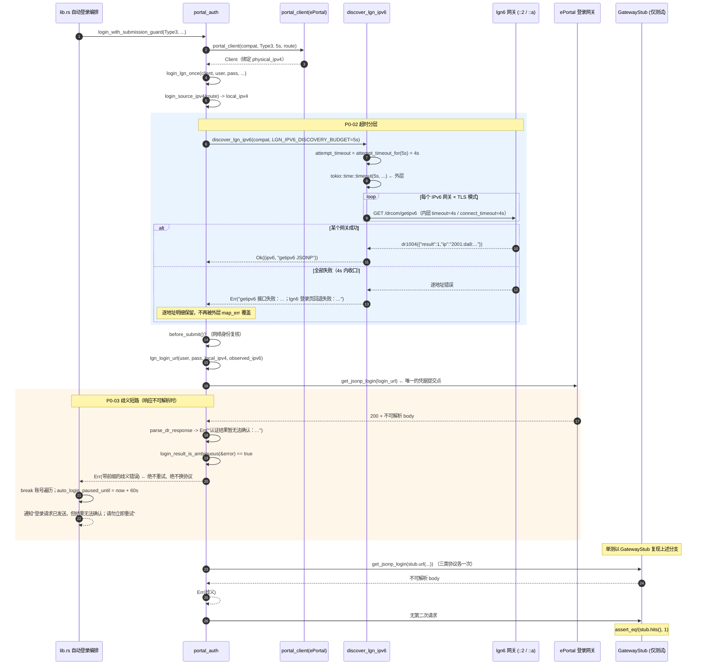
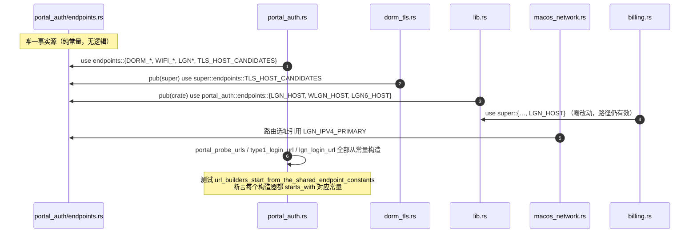
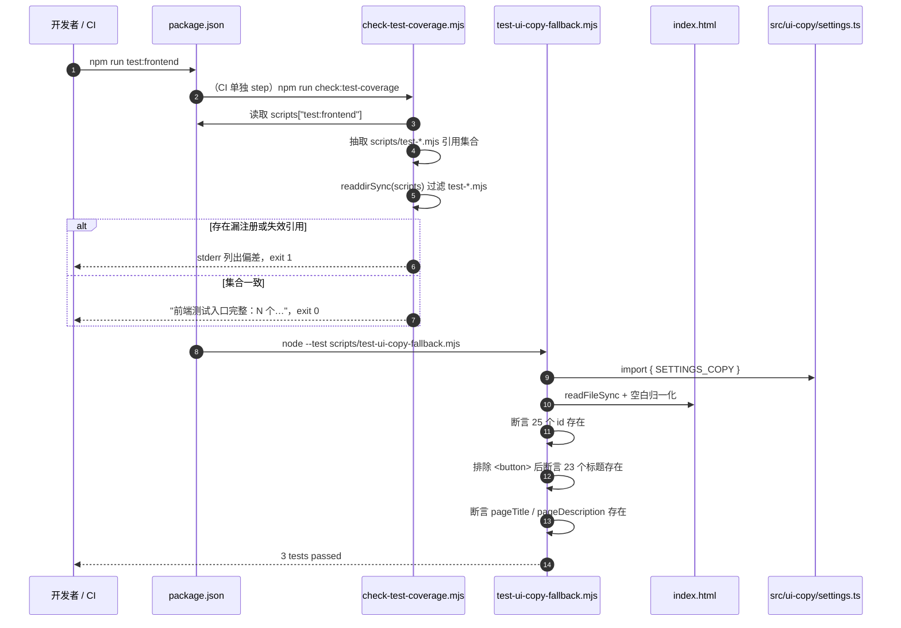
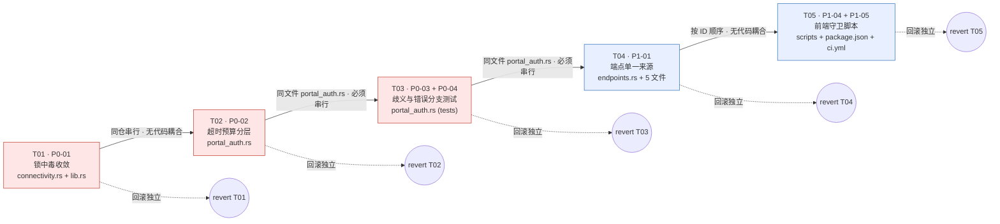

# 增量开发设计与任务分解（第一批：P0-01 / P0-02 / P0-03 / P0-04 / P1-01 / P1-04 / P1-05）

> 基线：分支 `feat/robustness-ipv6` @ `c90a187`（含 `docs/development-backlog.md`、`docs/ipv6-free-flow-research.md`）
> 上游输入：`docs/development-backlog.md`（PM，Alice）
> 本文档只做设计，**不含任何源代码改动、不提交**。
> 所有行号与计数均在 `c90a187` 工作树上用命令实测，不是估算。凡与 PM 清单不一致之处，以代码为准并在第 2 节逐条列出修正。

---

## 0. 结论摘要（先看这里）

1. **PM 清单里有 4 处与代码不符**，已在第 2 节逐条修正：
   - P0-02 的"内层 client timeout 在 1496/1589"是**误读**：1496/1589 是 ePortal 凭据客户端的超时，与 IPv6 发现无关；真正与外包超时同值的内层超时在 **1148 行**。
   - P0-03 的"Type1/Type2 是否受保护需实测"：**三条协议都已被保护**（`portal_auth.rs` 内每条协议恰好 1 个 `get_jsonp_login` 调用点；`lib.rs` 四处调用点都有 `login_result_is_ambiguous` 短路）。所以 P0-03 的实际缺口是**零回归测试**，不是缺保护；其验收标准第 3 条（"由失败转通过"）不可执行，已改写。
   - P1-01 的"字面量仅出现在 `endpoints.rs`"**做不到也不该做**：`10.21.251.3` 还出现在 `billing.rs:3858`（NAS IP 展示归类）、`10.21.251.3`/`172.30.201.2` 出现在 `billing/transport.rs:83,99`（校园服务 wire 改写）、`172.30.201.2` 出现在 `diagnostic_tools.rs:25`（ping 目标）。这些不是"登录端点"，硬搬会扩大爆炸半径。已改为**分级收敛 + 白名单式验收**。
   - P1-05 的验收标准"每个 key 的标题字符串都出现在 `index.html`"**当前即失败**：25 个 key 中 `btn-manage-whitelist`、`btn-manage-blacklist` 在 `index.html` 里是 `<button>`（可见文案为"管理"），其 `title` 是运行时 tooltip，`ui-text.ts::setSettingItem` 对它们恒为 no-op。已改为**双档断言**（id 必须存在；非按钮控件才断言标题存在）。
2. **P0-01 的真实锁中毒面是 14 处，不是 7 处**：`connectivity.rs` 非测试段 7 处（80/91/123/141-142/200/217/305），`lib.rs` 后台循环任务 5 处（8422/8465/8471/8479/8485），`lib.rs` 的 `link_health` 另有 2 处（545/7771）。只改 7 处会让"`invalidate` 能恢复但 `get_link_health` 仍 panic"的半修状态。
3. 全仓 `.lock()/.read()/.write() + .unwrap()` 实测 **188 处**，与 PM 描述一致；本批只动上述 14 处，其余不动。
4. 全批 **不新增运行时依赖、不改网络行为语义、不改目录结构**；P0-02 是唯一改行为数值的项，且总时长不劣于现状。
5. IPv6 行为改动（IPV6-04/05/06）**不在本设计范围**；只在第 6.4 节说明接口预留，不落地。

---

## 1. 实施方式（Implementation Approach）

### 1.1 核心技术难点

| 难点 | 为什么难 | 本设计的取舍 |
| --- | --- | --- |
| 锁中毒（poisoning）收敛 | `std::sync::Mutex` 中毒后 `.unwrap()` 永久 panic；后台 `loop` 任务一旦 panic 即静默停摆，用户只看到"再也不自动登录" | 逐点改为 `.unwrap_or_else(\|poison\| poison.into_inner())`。**不引入 helper 模块**（PM 禁止新抽象层），因为单行内联改法比新增模块 diff 更小、可读性更好、`clippy` 无告警 |
| 超时预算分层 | 外层 `tokio::time::timeout(budget)` 与内层 `reqwest::Client::timeout(budget)` 同值 → 外层几乎总先到期 → 逐地址失败原因被 `map_err` 吞掉 | 用**纯函数** `attempt_timeout_for(budget)` 由外层预算推导内层预算（预留 `min(budget/5, 1s)`）。总时长不变，只是把内层提前收口 |
| 歧义认证"仅提交一次" | 这是**账号锁定**风险面，不能靠"我记得没有重试"来保证 | 用**结构 + 测试**双保险：结构上每条协议只有 1 个 `get_jsonp_login` 调用点（可 grep 计数）；测试上用本地 HTTP 桩断言"桩只收到 1 次请求" |
| 端点单一来源 | 网关地址散落在 8 个文件；漏改一处即静默指向错地址 | 新建 `portal_auth/endpoints.rs`，**保持常量名不变**，用 `use` 引入，从而 30+ 个使用点零改动；golden 测试钉死常量值 |
| 离线可测的错误分支 | 校园网关不可达，任何真实网络测试都不可复现 | 在 `#[cfg(test)]` 下自建**单连接 HTTP 桩**（`TcpListener` + 手写响应），全部错误分支确定性可测 |

### 1.2 框架与库选型（不新增依赖）

| 用途 | 选择 | 理由 |
| --- | --- | --- |
| 并发原语 | `std::sync::Mutex/RwLock`（既有） | 中毒恢复语义就在 std 里，无需 `parking_lot` |
| 超时 | `tokio::time::timeout` + `reqwest::Client::timeout`（既有） | 只调数值，不换机制 |
| 测试 HTTP 桩 | `std::net::TcpListener` + `std::thread`（std） | 仓库已有同类写法（`portal_auth.rs:1916-1995` 的 IPv6 桩），沿用同一风格 |
| 前端脚本测试 | `node:test` + `node:assert/strict`（既有） | `test:frontend` 已用；`--experimental-strip-types` 可直接 import `.ts` |
| 前端脚本文件遍历 | `node:fs` / `node:path` / `node:url`（std） | 与 `scripts/check-versions.mjs` 同风格 |

**明确不引入**：`parking_lot`、`anyhow`、`thiserror`、`wiremock`、`mockito`、`nock`、任何测试框架。全部用 std + 既有 devDependencies。

### 1.3 架构模式

沿用既有分层，本批不改变任何一层边界：

```
lib.rs (Tauri commands / 后台 loop / AppState)
  └── portal_auth.rs          协议实现 + 端点常量（本批新增 endpoints 子模块）
        ├── portal_auth/endpoints.rs   ← 新增：唯一端点事实源（纯常量）
        ├── portal_auth/dorm_tls.rs     ← 改：常量改为 re-export
        └── portal_auth/lgn_ipv6_windows.rs（不动）
  └── connectivity.rs         探测池（本批：锁中毒收敛）
  └── billing/ transport.rs 等（本批不动，仅登记遗留字面量）
```

---

## 2. 对 PM 清单的修正（以代码为准）

| PM 原文 | 实测事实 | 本设计的处理 |
| --- | --- | --- |
| P0-01「`connectivity.rs` 非测试段 7 处…行 80/91/123/142/200/217/305」 | ✅ 完全正确。`awk '/#\[cfg\(test\)\]/{exit} 1' \| grep -c "unwrap()\|expect("` = **7**，且 7 处全是锁 | 采纳。但补上 `lib.rs` 的 7 处（5 处后台循环 + 2 处 `link_health`），否则是半修 |
| P0-01「`lib.rs` 后台任务函数内同类写法」 | 模糊。实测后台循环任务区间 `8415..8582` 内共 **5** 处（8422/8465/8471/8479/8485），另有 `link_health` 2 处（545/7771）在别的后台路径上 | 改为**精确行号清单**，共 14 处 |
| P0-02「内层 client `timeout`（行 1496/1589 附近）当前同为 5s」 | ❌ 误读。1496/1589 是 `portal_client(...)` 的 ePortal 凭据客户端超时，与 IPv6 发现无关。真正的耦合在 `discover_lgn_ipv6`：外层 `timeout(budget)`（1141 行）与内层 `lgn_ipv6_client_for(compatibility, **timeout**, ...)`（**1148 行**）传入的是**同一个变量**，内层再落到 `.timeout(t)`/`.connect_timeout(t)`（351/352 行） | 修正为 1141 / 1148 / 351-352 三处；1496/1589 不在 P0-02 范围 |
| P0-03「Type3 已有注释级保护，Type1/Type2 是否同样受保护需实测确认」 | ❌ 三条都已保护。① `portal_auth.rs` 内 `get_jsonp_login(` 共 **7** 次出现 = 1 定义 + **6** 调用点（Type1 登录 1531、Type2 登录 1548、Type3 登录 1104、Type1 注销 1618、Type2 注销 1634、Type3 注销 1655），每协议登录恰好 1 次提交；② `login_lgn_once` 的 `Err(error) if login_result_is_ambiguous(&error) => Err(error)`（1117 行）显式拒绝重试；③ `lib.rs` 四处调用点（2496 / 5230 / 6927 / 8208）都在歧义时 `break`/`return`，不遍历下一个账号 | P0-03 降级为**纯测试项**（test-only）。验收第 3 条"修复后由失败转通过"不可执行 → 改写为"桩请求计数 = 1 + 歧义错误传播链断言" |
| P0-03「`src-tauri/src/portal_auth/fixtures/`」需新增 | 该目录已存在，只有 `dorm-gateway-2024.pem`、`lgn-dual-stack.json` 两个文件 | 复用目录；P0-04 视需要新增 `gateway-error-bodies.json`（非必需，可用内联字面量） |
| P1-01「字面量仅出现在 `endpoints.rs`」 | ❌ 不可能。非测试段遗留：`billing.rs:3858`（`nas_ip == "10.21.251.3"` 展示归类）、`billing/transport.rs:83,99`（`"172.30.201.2"`/`"172.30.201.10"` 校园服务 wire 改写）、`diagnostic_tools.rs:25`（`"campus" => "172.30.201.2"` ping 目标） | 改为**两级**：本批收敛"登录/探测/路由选址"类端点（A 组，必须）；"展示归类 / 校园服务 wire / 诊断目标"三类（B 组）登记为 P1-02 覆盖配置时一并处理，本批不动。验收改为**白名单式**（第 3.5 节给出精确 grep 期望） |
| P1-01「`src-tauri/src/lib.rs`（2138–2140 `WLGN_HOST`/`LGN_HOST`/`LGN6_HOST`）」 | ✅ 正确 | 采纳。用 `pub(crate) use` 保持 `crate::LGN_HOST` 可解析，`billing.rs:1` 的 `use super::{... LGN_HOST}` 零改动 |
| P1-01「`dorm_tls.rs`（`TLS_HOST_CANDIDATES`）」 | ✅ 正确（13 行） | 改为 `pub(super) use super::endpoints::TLS_HOST_CANDIDATES;`，名称不变 → 5 个使用点零改动 |
| P1-04「脚本需容忍 `test-update-utils.mjs` 与 `--test` 两类执行方式」 | ✅ 正确，且更细：`test-config-crypto.mjs` 是 **assert 顶层自执行但被列入 `--test` 列表**（无 `test()` 调用，靠顶层 throw 失败）；`test-update-utils.mjs` 是顶层自执行且**不在** `--test` 列表 | 守卫脚本不判断执行方式，只做"磁盘文件 ↔ `test:frontend` 命令字符串引用"的集合比对 |
| P1-05「对 `SETTINGS_COPY.items` 每个 key 断言 id 存在**且标题字符串出现**」 | ❌ 当前即失败 2 项：`btn-manage-whitelist`、`btn-manage-blacklist` 在 `index.html:1149,1156` 是 `<button …>管理</button>`，其 `title` 只在运行时作为 tooltip 存在；`ui-text.ts:49-56` 的 `setSettingItem` 通过 `.closest('.setting-item') → .setting-info h4` 写入，对 `.setting-actions` 内的按钮恒为 `null`（no-op） | 改为双档：**全部 25 个 key 断言 `id="<key>"` 存在**（当前 25/25 通过）；**排除 `<button>` 后断言标题存在**（当前 23/23 通过）。判定"是否按钮"用正则 `<button[^>]*\bid="<key>"`，自描述、无硬编码白名单 |
| P1-05「`src/ui-copy/billing.ts`」在范围内 | `BILLING_COPY` 的 fallback 锚点是**类选择器**（`setBillingPanel` / `setBillingAction` 用 `.billing-center-panel` 等），不是 id，规则与 settings 完全不同 | v1 **不含 billing**，作为后续项登记（第 6.3 节）。避免用一个含混规则制造误报 |
| 「验证记录放 `docs/verification-<日期>.md`」 | ✅ 仓库已有 `docs/verification-2026-10-26.md`，格式为「改动范围 / 实际验证 / 尚需实机验收」三段表格 | 采纳，P0-02 的实机日志片段写进该文档的「尚需实机验收」段，不新建散文件 |

---

## 3. 逐项设计

### 3.1 P0-01 后台关键路径消除锁中毒 panic

**目标**：任一线程 panic 导致互斥锁中毒后，后台轮询与自动登录不再二次 panic 而静默停止。

**改动策略（最小 diff）：逐点内联替换，不新增模块、不新增函数。**

统一改法（每个点一行）：

```rust
// before
let mut pool = self.0.lock().unwrap();
// after
let mut pool = self.0.lock().unwrap_or_else(|poison| poison.into_inner());
```

`RwLock` 同理：`.read().unwrap()` → `.read().unwrap_or_else(|poison| poison.into_inner())`。

> 为什么不用 helper：`unwrap_or_else` 是 std 惯用法，`PoisonError::into_inner` 返回同类型 guard，语义是"接管被污染的数据继续用"。新增 `fn lock_or_recover<T>(m: &Mutex<T>) -> MutexGuard<'_, T>` 会把 14 处 1 行改成 14 处 1 行 + 1 个新模块，diff 更大且违反"不引入新抽象层"。

**精确改动点（14 处，全部为非 `#[cfg(test)]` 段）**

`src-tauri/src/connectivity.rs`（7 处；`#[cfg(test)]` 从 404 行开始）

| 行 | 所属函数 | 现文 | 改为 |
| --- | --- | --- | --- |
| 80 | `ProbePool::invalidate` | `self.0.lock().unwrap()` | `self.0.lock().unwrap_or_else(\|poison\| poison.into_inner())` |
| 91 | `ProbePool::subscribe` | 同上 | 同上 |
| 123 | `ProbePool::update` | 同上 | 同上 |
| 141-142 | `ProbePool::current` | `self.0\n.lock()\n.unwrap()` | `self.0\n.lock()\n.unwrap_or_else(\|poison\| poison.into_inner())` |
| 200 | `invalidate()` | `*state.link_health.lock().unwrap() = None;` | `*state.link_health.lock().unwrap_or_else(\|poison\| poison.into_inner()) = None;` |
| 217 | `observe()` | `&state.config.read().unwrap()` | `&state.config.read().unwrap_or_else(\|poison\| poison.into_inner())` |
| 305 | `observe()` 内 `dual_stack::probe_with_updates` 回调 | `*state.link_health.lock().unwrap() = Some(health.clone());` | 同 200 的写法 |

`src-tauri/src/lib.rs`（7 处）

| 行 | 所属 | 说明 |
| --- | --- | --- |
| 545 | `get_link_health`（Tauri command） | 与 `invalidate` 写同一把 `link_health`；不改则"写侧能恢复、读侧仍 panic"，属半修 |
| 7771 | `schedule_network_change_readiness` | `state.network_schedule.lock().unwrap().reset();` 在 7770 行也一并改为恢复式（同函数相邻语句，1 行）<br>`*state.link_health.lock().unwrap() = None;` |
| 8422 | 后台 loop 任务（`spawn` 起点 8415） | `loop_state.network_schedule.lock().unwrap().plan.interface_poll_seconds`（跨 3 行，改末行的 `.unwrap()`） |
| 8465 | 同上 | `&loop_state.last_network_state.lock().unwrap()` |
| 8471 | 同上 | `loop_state.network_schedule.lock().unwrap().plan.interface_poll_seconds` |
| 8479 | 同上 | `loop_state.config.read().unwrap()` |
| 8485 | 同上 | `loop_state.last_known_ip.lock().unwrap()` |

> 计数说明：`lib.rs` 后台循环任务共 5 处锁中毒点（8422/8465/8471/8479/8485），`link_health` 2 处（545/7771），另加 7770 行的 `network_schedule` 与 7771 同一语句块，实际编辑行数 = 8 行、覆盖 7 个逻辑点。合计 `connectivity.rs` 7 + `lib.rs` 8 行 = **15 行**改动。

**新增测试**

位置：`src-tauri/src/connectivity.rs` 的 `#[cfg(test)] mod tests`（404 行起），追加到模块末尾。

测试名：`poisoned_lock_does_not_panic`

```rust
#[test]
fn poisoned_lock_does_not_panic() {
    let pool = std::sync::Arc::new(ProbePool::default());
    // 让一个线程在持锁时 panic，使互斥锁进入中毒状态。
    let poisoner = pool.clone();
    assert!(std::thread::spawn(move || {
        let _guard = poisoner.0.lock().unwrap();
        panic!("poison the probe pool");
    })
    .join()
    .is_err());

    // 以下每个入口都必须恢复中毒的 guard，而不是二次 panic。
    assert_eq!(pool.invalidate(), 1);
    let (id, _receiver, started) = pool.subscribe("poisoned".into());
    assert!(started, "a poisoned pool must still start new work");
    assert!(pool.update(id, |value| value.complete = true));
    assert!(pool.current(id));
}
```

要点：
- `ProbePool.0` 是私有字段，`mod tests` 在同一模块内可直接访问（既有测试已这么用）。
- `invalidate()` 返回 `pool.next`，初值 0 → `wrapping_add(1)` = 1，断言稳定。
- 该测试在**未修复**代码上必然 panic（`invalidate` 第 80 行先炸），修复后通过——是真正的回归保护。
- `link_health` / `config` 两个 `AppState` 字段无法在单测里构造（需 `AppHandle`），由 P0-01 的 grep 门禁（见验收 1）覆盖。

**验收命令**

```bash
# 1) connectivity.rs 非测试段不得再有裸 unwrap/expect
awk '/#\[cfg\(test\)\]/{exit} 1' src-tauri/src/connectivity.rs | grep -c "unwrap()\|expect("   # 期望 0
# 2) lib.rs 后台路径 7 个逻辑点全部为恢复式
grep -c "unwrap_or_else(|poison| poison.into_inner())" src-tauri/src/connectivity.rs   # 期望 7
grep -c "unwrap_or_else(|poison| poison.into_inner())" src-tauri/src/lib.rs             # 期望 8
# 3) 全仓总量不减少（证明没有误伤别处）
grep -rn "\.lock()\.unwrap()\|\.read()\.unwrap()\|\.write()\.unwrap()" src-tauri/src/ | wc -l   # 改动前 188，改动后 174（188-14）
# 4) 新增测试通过
cargo test --manifest-path src-tauri/Cargo.toml poisoned_lock_does_not_panic
# 5) 既有门槛
cargo fmt --manifest-path src-tauri/Cargo.toml --all -- --check
cargo clippy --manifest-path src-tauri/Cargo.toml --all-targets -- -D warnings
cargo test --manifest-path src-tauri/Cargo.toml
```

**回滚方式**：`git revert <P0-01 commit>`。改动仅 15 行 + 1 个测试，零接口变化、零配置变化、零前端变化，回滚无副作用。

---

### 3.2 P0-02 登录阶段超时预算分层

**目标**：内层单请求超时严格短于外层阶段预算，超时后仍能拿到逐地址失败原因，不再退化为一句"IPv6 地址发现超时"。

**问题定位（实测）**

`discover_lgn_ipv6`（`portal_auth.rs:1122-1168`）：

```
1122 async fn discover_lgn_ipv6(compatibility, timeout: Duration, route_context) -> Result<(String, &'static str), String> {
1131     ...
1141     tokio::time::timeout(timeout, async {          // ← 外层预算
1146         let client = lgn_ipv6_client_for(
1147             compatibility,
1148             timeout,                                // ← 内层拿到同一个值
1149             route_context, address, *native_tls,
1150         )?;
1158         while let Some(result) = attempts.next().await { ... Err(error) => failures.push(error) }
1164         Err(failures.join("；"))                    // ← 逐地址明细在这里
1166     }).await
1167     .map_err(|_| "IPv6 地址发现超时（同接口选址与网关探测均未及时完成）".to_string())?
```

内层落到 `lgn_ipv6_client_for`（343-373）的 `.timeout(timeout)`（351）+ `.connect_timeout(timeout)`（352）。

因内层 == 外层，`tokio::time::timeout` 几乎总先到期，`Err(failures.join("；"))` 分支被 `map_err` 覆盖 → 逐地址原因丢失。这就是 PM 观察到的"退化为一句话"。

调用方（3 处）：
- `portal_auth.rs:1095` `login_lgn_once` → `Duration::from_secs(5)`
- `portal_auth.rs:1647` `logout_from_campus_network_rust` Type3 → `Duration::from_secs(5)`
- `portal_auth.rs:1186` `diagnose_lgn_ipv6_rust` → `NETWORK_PROBE_TIMEOUT`（`network_probe.rs:5` = 3s）

**改动策略（最小 diff：2 个常量 + 1 个纯函数 + 3 行调用）**

在 `portal_auth.rs` 常量区（60-88 行下方，紧跟 `EPORTAL_XOR_KEY` 之后）新增：

```rust
/// Total budget for one lgn IPv6 discovery attempt. This is the outer guard.
const LGN_IPV6_DISCOVERY_BUDGET: Duration = Duration::from_secs(5);

/// Every inner gateway attempt must finish strictly before the outer guard so
/// the aggregated per-address failure reasons survive instead of collapsing
/// into a single "discovery timed out" message.
const LGN_IPV6_ATTEMPT_RESERVE: Duration = Duration::from_secs(1);

/// Derives the inner per-request budget from the caller's outer budget.
/// The reserve is capped at one fifth of the budget so short diagnostic
/// budgets keep working, and it never increases the total wall time.
fn attempt_timeout_for(budget: Duration) -> Duration {
    budget.saturating_sub((budget / 5).min(LGN_IPV6_ATTEMPT_RESERVE))
}
```

推导结果：5s → 4s（预留 1s）；3s → 2.4s（预留 600ms）。**任何正预算都保证内层 < 外层**，且总时长不劣于现状（外层预算不变）。

在 `discover_lgn_ipv6` 内（1141 行之前）插入 1 行，并改 1148 行：

```rust
    let attempt_timeout = attempt_timeout_for(timeout);
    tokio::time::timeout(timeout, async {
        ...
            let client = lgn_ipv6_client_for(
                compatibility,
                attempt_timeout,      // ← 唯一语义改动
                ...
```

把 1095 / 1647 的 `Duration::from_secs(5)` 换成 `LGN_IPV6_DISCOVERY_BUDGET`（2 行，纯集中化，值不变）。

**不改**：`portal_client(... Duration::from_secs(5) ...)`（1496 / 1589）——那是 ePortal 凭据客户端超时，属另一层，本批不动（PM 原范围误含此二行）。1186 行的 `NETWORK_PROBE_TIMEOUT` 保持不动（诊断复用同一探测超时）。

**新增测试**

位置：`portal_auth.rs` 的 `#[cfg(test)] mod tests`（1725 行起），追加到模块末尾。

测试名：`ipv6_discovery_inner_timeout_stays_below_the_outer_budget`

```rust
#[test]
fn ipv6_discovery_inner_timeout_stays_below_the_outer_budget() {
    // 每个调用方的外层预算都必须严格大于推导出的内层预算。
    for budget in [LGN_IPV6_DISCOVERY_BUDGET, NETWORK_PROBE_TIMEOUT] {
        let inner = attempt_timeout_for(budget);
        assert!(inner < budget, "inner {inner:?} must stay below outer {budget:?}");
        assert!(inner > Duration::ZERO, "inner must remain usable");
    }
    // 预留量不超过预算的 1/5，短预算诊断场景不会被压到 0。
    assert_eq!(attempt_timeout_for(LGN_IPV6_DISCOVERY_BUDGET), Duration::from_secs(4));
    assert_eq!(attempt_timeout_for(NETWORK_PROBE_TIMEOUT), Duration::from_millis(2400));
    // 总时长不劣于现状：外层预算保持调用方给的值。
    assert_eq!(LGN_IPV6_DISCOVERY_BUDGET, Duration::from_secs(5));
}
```

**验收命令**

```bash
# 1) 数值集中为常量且调用方不再散落字面量
grep -n "LGN_IPV6_DISCOVERY_BUDGET\|LGN_IPV6_ATTEMPT_RESERVE\|attempt_timeout_for" src-tauri/src/portal_auth.rs   # 期望 ≥6 行
grep -c "discover_lgn_ipv6(compatibility, Duration::from_secs(5)" src-tauri/src/portal_auth.rs                     # 期望 0
# 2) 内层严格小于外层
cargo test --manifest-path src-tauri/Cargo.toml ipv6_discovery_inner_timeout_stays_below_the_outer_budget
# 3) portal_auth 全部测试仍绿
cargo test --manifest-path src-tauri/Cargo.toml portal_auth
# 4) 既有门槛
cargo fmt --manifest-path src-tauri/Cargo.toml --all -- --check
cargo clippy --manifest-path src-tauri/Cargo.toml --all-targets -- -D warnings
cargo test --manifest-path src-tauri/Cargo.toml
```

**实机验收（写入 `docs/verification-<日期>.md` 的「尚需实机验收」段）**：在双栈校园网中让 lgn IPv6 网关不可达（或拔掉 v6），触发一次自动登录，日志中 `IPv6 地址发现失败，已提交单 IPv4 认证：` 之后必须出现**逐地址明细**（`getipv6 接口失败：…；lgn6 登录页回退失败：…`），而不是 `IPv6 地址发现超时（同接口选址与网关探测均未及时完成）`。同时确认登录总耗时 ≤ 改动前。

**回滚方式**：`git revert <P0-02 commit>`。回滚后 `attempt_timeout_for` 消失、1148 行回到 `timeout`，行为逐字节回到 `c90a187`。

---

### 3.3 P0-03 歧义认证结果不重复提交凭据（test-only）

**目标**：用回归测试钉死"凭据已提交但响应不可解析时，绝不重试、绝不切换到第二套协议"。

**保护现状（实测，已存在，无需修复）**

| 层 | 证据 | 作用 |
| --- | --- | --- |
| 解析层 | `parse_dr_response`（856-896）5 个失败出口全部以 `AMBIGUOUS_LOGIN_RESULT` 开头 | 错误可判别 |
| 提交层 | `get_jsonp_login(` 全文件 7 次 = 1 定义 + 6 调用点；**每协议登录恰好 1 个调用点**（Type1=1531，Type2=1548，Type3=1104） | 结构上不存在"第二次提交" |
| 协议层 | `login_lgn_once` 1117：`Err(error) if login_result_is_ambiguous(&error) => Err(error)` | 拒绝 IPv4 重试 |
| 编排层 | `lib.rs:2496`、`5230`、`6927`、`8208` 四处：歧义时 `break` / `return`，不遍历下一个账号，并设置 `auto_login_paused_until`（5233 行 +60s） | 拒绝切换账号/协议 |

**结论**：P0-03 **不改生产代码**。PM 验收第 3 条（"若发现某协议存在重试，修复后同一测试由失败转通过"）不可执行，已替换为下面的结构性 + 行为性断言。

**新增测试（2 个）**

先新增**测试专用 HTTP 桩**（放在 `portal_auth.rs` 的 `#[cfg(test)] mod tests` 内，作为 `mod tests` 的子模块，不新建文件、不影响生产代码）：

```rust
    /// 单连接、单响应的本地 HTTP 桩：用于断言"凭据只被提交一次"以及
    /// 各类传输/解析失败的错误语义。仅测试可见，不进入生产代码。
    mod gateway_stub {
        use std::io::{BufRead, BufReader, Write};
        use std::net::TcpListener;
        use std::sync::atomic::{AtomicUsize, Ordering};
        use std::sync::Arc;

        pub(super) struct GatewayStub {
            port: u16,
            hits: Arc<AtomicUsize>,
        }

        impl GatewayStub {
            /// `respond` 返回要写回的完整 HTTP 响应字节。
            pub(super) fn start(respond: impl Fn() -> Vec<u8> + Send + 'static) -> Self {
                let listener = TcpListener::bind(("127.0.0.1", 0)).unwrap();
                let port = listener.local_addr().unwrap().port();
                let hits = Arc::new(AtomicUsize::new(0));
                let counter = hits.clone();
                std::thread::spawn(move || {
                    for stream in listener.incoming() {
                        let Ok(mut stream) = stream else { break };
                        counter.fetch_add(1, Ordering::SeqCst);
                        // 读掉请求头，保证客户端不会因未读而卡在写侧。
                        let mut reader = BufReader::new(stream.try_clone().unwrap());
                        let mut line = String::new();
                        while reader.read_line(&mut line).unwrap_or(0) > 0 && line != "\r\n" {
                            line.clear();
                        }
                        let _ = stream.write_all(&respond());
                        let _ = stream.flush();
                    }
                });
                Self { port, hits }
            }

            pub(super) fn url(&self, path_and_query: &str) -> Url {
                Url::parse(&format!("http://127.0.0.1:{}{path_and_query}", self.port)).unwrap()
            }

            pub(super) fn hits(&self) -> usize {
                self.hits.load(Ordering::SeqCst)
            }
        }

        /// 供 `get_jsonp_login` 使用的直连客户端：不绑定物理网卡、不走代理。
        pub(super) fn client(timeout: Duration) -> Client {
            Client::builder()
                .timeout(timeout)
                .redirect(reqwest::redirect::Policy::none())
                .no_proxy()
                .use_rustls_tls()
                .build()
                .unwrap()
        }
    }
```

> 该桩与仓库既有写法（`portal_auth.rs:1916-1995` 的 IPv6 桩）同构，只是补了请求计数与可编程响应。**不新增任何 dev-dependency。**

测试 1：`ambiguous_gateway_response_submits_credentials_exactly_once`

```rust
    #[test]
    fn ambiguous_gateway_response_submits_credentials_exactly_once() {
        use gateway_stub::{client, GatewayStub};
        // 三类协议各自解析同一份"不可解析"响应：网关返回 200 但 body 不是 JSONP。
        for label in ["bjut-sushe 登录", "bjut_wifi 登录", "lgn 有线登录"] {
            let stub = GatewayStub::start(|| {
                b"HTTP/1.1 200 OK\r\nContent-Type: text/html\r\nContent-Length: 20\r\nConnection: close\r\n\r\n<html>gateway fault</html>"
                    .to_vec()
            });
            let url = stub.url("/eportal/portal/login?callback=dr1003");
            let runtime = tokio::runtime::Runtime::new().unwrap();
            let error = runtime
                .block_on(get_jsonp_login(&client(Duration::from_secs(2)), url, "http://127.0.0.1/", label, None, None))
                .expect_err("an unparsable gateway response must not be treated as success");
            assert!(login_result_is_ambiguous(&error), "{label}: {error}");
            assert_eq!(stub.hits(), 1, "{label} must submit credentials exactly once");
        }
    }
```

测试 2：`ambiguous_login_errors_never_trigger_a_protocol_switch`

```rust
    #[test]
    fn ambiguous_login_errors_never_trigger_a_protocol_switch() {
        // parse_dr_response 的每个失败出口都必须被 login_result_is_ambiguous
        // 认出来，否则 1117 行的短路失效、会落到"换协议/换账号"分支。
        for body in [
            "",                              // 空响应
            "OK",                            // 无 JSONP 括号
            "dr1003({\"result\":1",          // JSONP 不完整
            "dr1003(not-json);",             // 括号内不可解析
            "dr1003({\"msg\":\"ok\"});",     // 缺 result 字段
            "dr1003({\"result\":7});",       // 未知 result 值
        ] {
            let error = parse_dr_response(body).expect_err("must not parse as a login result");
            assert!(login_result_is_ambiguous(&error), "{body:?} -> {error}");
        }
        // 反向：真正的业务失败不是歧义，允许按既有策略遍历下一个账号。
        let (success, _) = parse_dr_response(r#"dr1002({"result":0,"msga":"密码错误"});"#).unwrap();
        assert!(!success);
    }
```

**验收命令**

```bash
cargo test --manifest-path src-tauri/Cargo.toml ambiguous
# 结构门禁：每协议登录恰好一个凭据提交点
grep -c "get_jsonp_login(" src-tauri/src/portal_auth.rs          # 期望 7（1 定义 + 6 调用）
grep -c "login_result_is_ambiguous(" src-tauri/src/lib.rs        # 期望 4
# 纯测试改动门禁：生产代码零改动
git diff --stat -- src-tauri/src/portal_auth.rs src-tauri/src/lib.rs   # 只应有 tests 模块内的行
cargo fmt --manifest-path src-tauri/Cargo.toml --all -- --check
cargo clippy --manifest-path src-tauri/Cargo.toml --all-targets -- -D warnings
cargo test --manifest-path src-tauri/Cargo.toml
```

**回滚方式**：`git revert <P0-03 commit>`。纯测试，回滚零风险。

---

### 3.4 P0-04 登录错误分支测试补齐

**目标**：三类协议的主要失败形态有回归保护，后续改动不会静默劣化错误语义。

**改动策略**：**纯测试**。复用 P0-03 引入的 `gateway_stub`，新增 6 个用例，覆盖 PM 要求的 6 种形态。非测试代码零改动。

**新增测试（6 个，全部追加到 `portal_auth.rs::tests`）**

| # | 测试名 | 构造方式 | 断言要点 |
| --- | --- | --- | --- |
| 1 | `gateway_connect_timeout_is_reported_as_a_timeout` | 桩 `accept` 后**不回写**任何字节（`respond` 返回 `vec![]`）；客户端 `timeout(300ms)` | 错误含 `请求超时`；`error` 不以 `AMBIGUOUS_LOGIN_RESULT` 开头（传输层失败 ≠ 提交后歧义） |
| 2 | `gateway_connection_refused_is_reported_as_a_connect_failure` | 先 `TcpListener::bind` 拿端口后**立即 drop**，再用该端口构造 URL | 错误含 `连接或 TLS 握手失败`；错误被 `AMBIGUOUS_LOGIN_RESULT` 前缀包裹（见下方注） |
| 3 | `gateway_tls_handshake_failure_is_reported_as_a_connect_failure` | 桩监听 TCP 但回写**明文 HTTP**，URL 用 `https://127.0.0.1:<port>/...` + `use_rustls_tls()` 客户端 | rustls 握手失败；错误含 `连接或 TLS 握手失败` |
| 4 | `gateway_unparsable_jsonp_is_reported_as_ambiguous` | 200 + `dr1003(not-json);` | `login_result_is_ambiguous(&error)` 为真；错误含 `响应无法解析` |
| 5 | `gateway_empty_body_is_reported_as_ambiguous` | 200 + `Content-Length: 0` | `login_result_is_ambiguous(&error)` 为真；错误含 `未返回预期 JSONP 响应` |
| 6 | `gateway_non_success_status_is_reported_with_its_code` | 503 + 任意 body | 错误含 `HTTP 503`；`login_result_is_ambiguous` 为**假**（HTTP 层拒绝，网关未受理凭据，允许按既有策略继续） |

> **注（用例 2 的语义要小心）**：`get_jsonp_login` 对传输错误返回 `portal_request_error(...)` 的结果，**不带** `AMBIGUOUS_LOGIN_RESULT` 前缀；而 `login_lgn_once` 在 1118 行会把非歧义错误**包上**前缀（`format!("{AMBIGUOUS_LOGIN_RESULT}：{error}；{diagnostic}")`）。所以：
> - 直接测 `get_jsonp_login`（用例 1/2/3/6）→ 断言"不含前缀"。
> - 测经 `login_lgn_once` 包装后的结果 → 断言"含前缀"。
> 本设计选择**直接测 `get_jsonp_login`**，断言更精确、不依赖 `login_lgn_once` 的 IPv6 发现副作用（后者会真连 `2001:da8:216:30c9::2`，离线环境会拖 4s 且不确定）。
> 用例 2 因此断言：错误含 `连接或 TLS 握手失败`，且 `login_result_is_ambiguous(&error)` **为假**——这正是"传输层失败允许重试、提交后不可解析不允许重试"的边界，是本次加固最值得钉死的一条语义。

**验收命令**

```bash
cargo test --manifest-path src-tauri/Cargo.toml gateway_          # 期望 6 passed
cargo test --manifest-path src-tauri/Cargo.toml portal_auth       # 全绿
# 非测试代码零改动门禁
git diff --stat                                                    # 仅 portal_auth.rs 的 tests 段
git diff -- src-tauri/src/portal_auth.rs | grep -E "^[+-]" | grep -v "^[+-][+-]" | grep -vE "^\+\s{4,}" | head
cargo fmt --manifest-path src-tauri/Cargo.toml --all -- --check
cargo clippy --manifest-path src-tauri/Cargo.toml --all-targets -- -D warnings
cargo test --manifest-path src-tauri/Cargo.toml
```

**回滚方式**：`git revert <P0-04 commit>`。纯测试。

---

### 3.5 P1-01 网关端点收敛为单一来源

**目标**：所有**生产用**登录/探测/路由选址端点集中一处，后续 P1-02 可配置化只改一个模块。

**范围分级（关键修正）**

**A 组：本批必须收敛（登录链路真正拨号的端点）**

| 现位置 | 现内容 | 目标常量（`endpoints.rs`） |
| --- | --- | --- |
| `portal_auth.rs:60` | `DORM_HTTP_LOGIN = "http://10.21.221.98:801/eportal/portal/login"` | `DORM_HTTP_LOGIN` |
| `portal_auth.rs:61` | `DORM_HTTP_REFERER = "http://10.21.221.98/"` | `DORM_HTTP_REFERER` |
| `portal_auth.rs:62` | `DORM_HTTPS_AUTHORITY = "10.21.221.98:802"` | `DORM_HTTPS_AUTHORITY` |
| `portal_auth.rs:63` | `DORM_HTTPS_REFERER = "https://10.21.221.98:802/"` | `DORM_HTTPS_REFERER` |
| `portal_auth.rs:71` | `DORM_GATEWAY_IPV4 = Ipv4Addr::new(10,21,221,98)` | `DORM_GATEWAY_IPV4` |
| `portal_auth.rs:72-75` | `LGN6_GATEWAY_IPV6 = [..::2, ..::a]` | `LGN6_GATEWAY_IPV6` |
| `portal_auth.rs:76,78,80` | `WIFI_HTTP_LOGIN/LOGOUT/REFERER`（`10.21.251.3`） | 同名 |
| `portal_auth.rs:77,79,81` | `WIFI_HTTPS_LOGIN/LOGOUT/REFERER`（`wlgn.bjut.edu.cn`） | 同名 |
| `portal_auth.rs:82,83` | `LGN_REFERER` / `LGN_ROOT` | 同名 |
| `portal_auth.rs:84` | `LGN6_ROOT` | `LGN6_ROOT` |
| `lib.rs:2138-2140` | `WLGN_HOST` / `LGN_HOST` / `LGN6_HOST` | 同名 |
| `dorm_tls.rs:13` | `TLS_HOST_CANDIDATES = ["wlgn.bjut.edu.cn", "lgn.bjut.edu.cn"]` | `TLS_HOST_CANDIDATES = [WLGN_HOST, LGN_HOST]` |
| `portal_auth.rs:246` | `vec![Ipv4Addr::new(10,21,251,3)]` | 改用 `WIFI_GATEWAY_IPV4` |
| `portal_auth.rs:250-253` | `Ipv4Addr::new(172,30,201,2)` / `(172,30,201,10)` | 改用 `LGN_IPV4_GATEWAYS` |
| `portal_auth.rs:408` | `primary.replacen("172.30.201.2", "172.30.201.10", 1)` | 改用 `LGN_IPV4_GATEWAYS` |
| `portal_auth.rs:453` | `"http://10.21.251.3/drcom/chkstatus"` | 新增 `WIFI_HTTP_CHKSTATUS` |
| `portal_auth.rs:455` | `"https://wlgn.bjut.edu.cn/drcom/chkstatus"` | 新增 `WIFI_HTTPS_CHKSTATUS` |
| `portal_auth.rs:950` | `Url::parse("https://lgn6.bjut.edu.cn/drcom/getipv6")` | 新增 `LGN6_OBSERVED_IPV6` |
| `portal_auth.rs:967` | `"https://lgn.bjut.edu.cn:802/eportal/portal/login"` | 新增 `LGN_HTTPS_LOGIN` |
| `portal_auth.rs:1007` | `"https://lgn.bjut.edu.cn:802/eportal/portal/logout"` | 新增 `LGN_HTTPS_LOGOUT` |
| `portal_auth.rs:1046` | `"http://172.30.201.2:801/eportal/portal/page/loadUserInfo"` | 新增 `LGN_HTTP_USER_INFO` |
| `portal_auth.rs:1048` | `"https://lgn.bjut.edu.cn:802/eportal/portal/page/loadUserInfo"` | 新增 `LGN_HTTPS_USER_INFO` |
| `portal_auth.rs:1090,1645` | `login_source_ipv4(.., "172.30.201.2:802", ..)`（仅作错误文案标签） | 新增 `LGN_HTTPS_AUTHORITY` |
| `portal_auth.rs:1503,1505,1602,1604` | `"10.21.221.98:801"` / `"10.21.221.98:802"`（仅作错误文案标签） | 新增 `DORM_HTTP_AUTHORITY` / 复用 `DORM_HTTPS_AUTHORITY` |
| `lib.rs:690` | `route_source_ipv4("10.21.251.3:80")` | 新增 `WIFI_ROUTE_PROBE = "10.21.251.3:80"` |
| `lib.rs:791` | `linux_route_identity("172.30.201.2")` | 新增 `LGN_IPV4_PRIMARY = "172.30.201.2"` |
| `macos_network.rs:68` | `macos_route_interface("172.30.201.2")` | 同上 |

**B 组：本批明确不动（登记为 P1-02 一并处理）**

| 位置 | 原因 |
| --- | --- |
| `billing.rs:3858` | `nas_ip == "10.21.251.3"` 是**展示归类**（把计费记录标成 `bjut_wifi`），不是拨号端点；且同函数还有 `10.21.221.97` 这类"网关侧观测 IP"，与用户可配置端点语义不同 |
| `billing/transport.rs:83,99` | 校园服务 wire 改写（VPN Maximum 模式下 https→http 映射）。属 `billing` 子系统，有自己的 `LGN_HOST` 依赖；P1-02 引入覆盖配置时必须同步，但本批不做以免一次改动跨两个子系统 |
| `diagnostic_tools.rs:25` | `"campus" => Some("172.30.201.2")` 是 ping/traceroute 目标列表（同表还有 `223.5.5.5` 等公网目标），不是登录端点 |
| `log_redaction.rs:325,376` | 均在 `#[cfg(test)]`（269 行起）内，测试夹具 |
| `lib.rs:9776-9795`、`portal_auth.rs` tests、`fixtures/*.json` | 测试代码/测试数据 |

**新增文件：`src-tauri/src/portal_auth/endpoints.rs`**

```rust
//! Single source of truth for every campus gateway endpoint the app dials.
//! Defaults are the values captured from the live portal flows; P1-02 will let
//! users override them, so nothing outside this module may hardcode them.
use std::net::{Ipv4Addr, Ipv6Addr};

// ---- bjut-sushe (dorm, ePortal on 10.21.221.98) ----
pub(crate) const DORM_GATEWAY_IPV4: Ipv4Addr = Ipv4Addr::new(10, 21, 221, 98);
pub(crate) const DORM_HTTP_LOGIN: &str = "http://10.21.221.98:801/eportal/portal/login";
pub(crate) const DORM_HTTP_AUTHORITY: &str = "10.21.221.98:801";
pub(crate) const DORM_HTTP_REFERER: &str = "http://10.21.221.98/";
pub(crate) const DORM_HTTPS_AUTHORITY: &str = "10.21.221.98:802";
pub(crate) const DORM_HTTPS_REFERER: &str = "https://10.21.221.98:802/";

// ---- bjut_wifi (Dr.COM on 10.21.251.3 / wlgn) ----
pub(crate) const WIFI_GATEWAY_IPV4: Ipv4Addr = Ipv4Addr::new(10, 21, 251, 3);
pub(crate) const WIFI_ROUTE_PROBE: &str = "10.21.251.3:80";
pub(crate) const WLGN_HOST: &str = "wlgn.bjut.edu.cn";
pub(crate) const WIFI_HTTP_LOGIN: &str = "http://10.21.251.3/drcom/login";
pub(crate) const WIFI_HTTP_LOGOUT: &str = "http://10.21.251.3/drcom/logout";
pub(crate) const WIFI_HTTP_CHKSTATUS: &str = "http://10.21.251.3/drcom/chkstatus";
pub(crate) const WIFI_HTTP_REFERER: &str = "http://10.21.251.3/";
pub(crate) const WIFI_HTTPS_LOGIN: &str = "https://wlgn.bjut.edu.cn/drcom/login";
pub(crate) const WIFI_HTTPS_LOGOUT: &str = "https://wlgn.bjut.edu.cn/drcom/logout";
pub(crate) const WIFI_HTTPS_CHKSTATUS: &str = "https://wlgn.bjut.edu.cn/drcom/chkstatus";
pub(crate) const WIFI_HTTPS_REFERER: &str = "https://wlgn.bjut.edu.cn/";

// ---- lgn (wired, 172.30.201.2 / 172.30.201.10 + lgn6) ----
pub(crate) const LGN_HOST: &str = "lgn.bjut.edu.cn";
pub(crate) const LGN6_HOST: &str = "lgn6.bjut.edu.cn";
pub(crate) const LGN_IPV4_PRIMARY: &str = "172.30.201.2";
pub(crate) const LGN_IPV4_GATEWAYS: [Ipv4Addr; 2] =
    [Ipv4Addr::new(172, 30, 201, 2), Ipv4Addr::new(172, 30, 201, 10)];
pub(crate) const LGN6_GATEWAY_IPV6: [Ipv6Addr; 2] = [
    Ipv6Addr::new(0x2001, 0x0da8, 0x0216, 0x30c9, 0, 0, 0, 0x0002),
    Ipv6Addr::new(0x2001, 0x0da8, 0x0216, 0x30c9, 0, 0, 0, 0x000a),
];
pub(crate) const LGN_HTTPS_AUTHORITY: &str = "172.30.201.2:802";
pub(crate) const LGN_HTTPS_LOGIN: &str = "https://lgn.bjut.edu.cn:802/eportal/portal/login";
pub(crate) const LGN_HTTPS_LOGOUT: &str = "https://lgn.bjut.edu.cn:802/eportal/portal/logout";
pub(crate) const LGN_HTTP_USER_INFO: &str = "http://172.30.201.2:801/eportal/portal/page/loadUserInfo";
pub(crate) const LGN_HTTPS_USER_INFO: &str = "https://lgn.bjut.edu.cn:802/eportal/portal/page/loadUserInfo";
pub(crate) const LGN6_OBSERVED_IPV6: &str = "https://lgn6.bjut.edu.cn/drcom/getipv6";
pub(crate) const LGN_REFERER: &str = "https://lgn.bjut.edu.cn/";
pub(crate) const LGN_ROOT: &str = "https://lgn.bjut.edu.cn/";
pub(crate) const LGN6_ROOT: &str = "https://lgn6.bjut.edu.cn/";

/// Official BJUT hostnames used as TLS SNI/Host aliases while DNS is pinned to
/// the dorm gateway. Limited to hostnames already present in captured traffic.
pub(crate) const TLS_HOST_CANDIDATES: [&str; 2] = [WLGN_HOST, LGN_HOST];
```

**接线（关键：保持常量名不变，使用点零改动）**

1. `portal_auth.rs:20-22` 的模块声明改为：
   ```rust
   pub(crate) mod endpoints;
   mod dorm_tls;
   ```
2. `portal_auth.rs:1-4` 的 `use super::{... LGN6_HOST, LGN_HOST, WLGN_HOST}` 改为：
   ```rust
   use super::{query_campus_dns_ipv4, redact_request_error, usable_physical_ipv4, VpnCompatibility};
   use endpoints::{
       DORM_GATEWAY_IPV4, DORM_HTTPS_AUTHORITY, DORM_HTTPS_REFERER, DORM_HTTP_AUTHORITY,
       DORM_HTTP_LOGIN, DORM_HTTP_REFERER, LGN6_GATEWAY_IPV6, LGN6_HOST, LGN6_OBSERVED_IPV6,
       LGN6_ROOT, LGN_HOST, LGN_HTTPS_AUTHORITY, LGN_HTTPS_LOGIN, LGN_HTTPS_LOGOUT,
       LGN_HTTP_USER_INFO, LGN_HTTPS_USER_INFO, LGN_IPV4_GATEWAYS, LGN_REFERER, LGN_ROOT,
       WIFI_GATEWAY_IPV4, WIFI_HTTP_CHKSTATUS, WIFI_HTTP_LOGIN, WIFI_HTTP_LOGOUT,
       WIFI_HTTP_REFERER, WIFI_HTTPS_CHKSTATUS, WIFI_HTTPS_LOGIN, WIFI_HTTPS_LOGOUT,
       WIFI_HTTPS_REFERER, WLGN_HOST,
   };
   ```
3. 删除 `portal_auth.rs:60-88` 的常量块（`LGN_PROGRAM_INDEX` / `LGN_PAGE_INDEX` / `LGN_JS_VERSION` / `EPORTAL_XOR_KEY` 保留原位，它们不是端点）。
4. `lib.rs:2138-2140` 三行常量替换为：
   ```rust
   pub(crate) use portal_auth::endpoints::{LGN6_HOST, LGN_HOST, WLGN_HOST};
   ```
   → `billing.rs:1` 的 `use super::{... LGN_HOST}`、`billing/transport.rs` 的 `use super::*` 全部零改动。
5. `dorm_tls.rs:11-13` 的 `pub(super) const TLS_HOST_CANDIDATES` 替换为：
   ```rust
   pub(super) use super::endpoints::TLS_HOST_CANDIDATES;
   ```
   → `portal_auth.rs:241,397,1430,2265,2270` 与 `dorm_tls.rs:42,161,199,240,273,287` 零改动。
6. `macos_network.rs:68`、`lib.rs:690/791` 各改 1 行引用。

**新增测试（2 个）**

测试 1（`endpoints.rs` 末尾，`#[cfg(test)] mod tests`）：`endpoint_constants_are_the_captured_gateway_values`

```rust
#[test]
fn endpoint_constants_are_the_captured_gateway_values() {
    // 逐字快照：任何端点值变化都必须显式改这个测试，避免静默指向错地址。
    assert_eq!(DORM_HTTP_LOGIN, "http://10.21.221.98:801/eportal/portal/login");
    assert_eq!(DORM_HTTP_AUTHORITY, "10.21.221.98:801");
    assert_eq!(DORM_HTTP_REFERER, "http://10.21.221.98/");
    assert_eq!(DORM_HTTPS_AUTHORITY, "10.21.221.98:802");
    assert_eq!(DORM_HTTPS_REFERER, "https://10.21.221.98:802/");
    assert_eq!(WIFI_HTTP_LOGIN, "http://10.21.251.3/drcom/login");
    assert_eq!(WIFI_HTTP_LOGOUT, "http://10.21.251.3/drcom/logout");
    assert_eq!(WIFI_HTTP_CHKSTATUS, "http://10.21.251.3/drcom/chkstatus");
    assert_eq!(WIFI_HTTPS_LOGIN, "https://wlgn.bjut.edu.cn/drcom/login");
    assert_eq!(WIFI_HTTPS_LOGOUT, "https://wlgn.bjut.edu.cn/drcom/logout");
    assert_eq!(WIFI_HTTPS_CHKSTATUS, "https://wlgn.bjut.edu.cn/drcom/chkstatus");
    assert_eq!(LGN_HTTPS_LOGIN, "https://lgn.bjut.edu.cn:802/eportal/portal/login");
    assert_eq!(LGN_HTTPS_LOGOUT, "https://lgn.bjut.edu.cn:802/eportal/portal/logout");
    assert_eq!(LGN_HTTP_USER_INFO, "http://172.30.201.2:801/eportal/portal/page/loadUserInfo");
    assert_eq!(LGN_HTTPS_USER_INFO, "https://lgn.bjut.edu.cn:802/eportal/portal/page/loadUserInfo");
    assert_eq!(LGN6_OBSERVED_IPV6, "https://lgn6.bjut.edu.cn/drcom/getipv6");
    assert_eq!(LGN_REFERER, "https://lgn.bjut.edu.cn/");
    assert_eq!(LGN_ROOT, "https://lgn.bjut.edu.cn/");
    assert_eq!(LGN6_ROOT, "https://lgn6.bjut.edu.cn/");
    assert_eq!(WIFI_ROUTE_PROBE, "10.21.251.3:80");
    assert_eq!(LGN_IPV4_PRIMARY, "172.30.201.2");
    assert_eq!(LGN_HTTPS_AUTHORITY, "172.30.201.2:802");

    // IP 常量与 URL 常量必须自洽（防止只改一处）。
    assert_eq!(DORM_GATEWAY_IPV4.to_string(), "10.21.221.98");
    assert!(DORM_HTTP_LOGIN.contains(&DORM_GATEWAY_IPV4.to_string()));
    assert!(DORM_HTTPS_REFERER.contains(&DORM_GATEWAY_IPV4.to_string()));
    assert_eq!(WIFI_GATEWAY_IPV4.to_string(), "10.21.251.3");
    assert!(WIFI_HTTP_LOGIN.contains(&WIFI_GATEWAY_IPV4.to_string()));
    assert_eq!(
        LGN_IPV4_GATEWAYS.map(|address| address.to_string()),
        ["172.30.201.2".to_string(), "172.30.201.10".to_string()]
    );
    assert!(LGN_HTTP_USER_INFO.contains(&LGN_IPV4_GATEWAYS[0].to_string()));
    assert_eq!(
        LGN6_GATEWAY_IPV6.map(|address| address.to_string()),
        ["2001:da8:216:30c9::2".to_string(), "2001:da8:216:30c9::a".to_string()]
    );
    assert_eq!(TLS_HOST_CANDIDATES, [WLGN_HOST, LGN_HOST]);
}
```

> 注意：既有测试 `lgn6_fixed_resolver_uses_the_observed_ipv6_gateways`（`portal_auth.rs:2004-2012`）已经断言了同一组 IPv6 网关值。新测试对它是**冗余但不同层**（常量层 vs 使用层），保留两者；PM 要求"现有 URL 相关测试断言不改"，本设计不改动任何既有断言。

测试 2（`portal_auth.rs::tests` 末尾）：`url_builders_start_from_the_shared_endpoint_constants`

```rust
#[test]
fn url_builders_start_from_the_shared_endpoint_constants() {
    // 每个 URL 构造器都必须从 endpoints.rs 的常量出发，而不是各自写字面量。
    assert_eq!(type1_https_login_base(WLGN_HOST), format!("https://{WLGN_HOST}:802/eportal/portal/login"));
    assert!(type1_probe_url(DORM_HTTP_LOGIN, None).starts_with("http://10.21.221.98:801/eportal/portal/page/loadConfig?"));
    assert!(type2_probe_url(VpnCompatibility::Maximum).starts_with(WIFI_HTTP_CHKSTATUS));
    assert!(type2_probe_url(VpnCompatibility::High).starts_with(WIFI_HTTPS_CHKSTATUS));
    assert_eq!(lgn_observed_ipv6_url().unwrap().origin().ascii_serialization(),
        Url::parse(LGN6_OBSERVED_IPV6).unwrap().origin().ascii_serialization());
    let lgn_max = lgn_user_info_url(VpnCompatibility::Maximum);
    assert!(lgn_max.starts_with(LGN_HTTP_USER_INFO));
    let lgn_high = lgn_user_info_url(VpnCompatibility::High);
    assert!(lgn_high.starts_with(LGN_HTTPS_USER_INFO));
    let (secondary, primary) = portal_probe_urls(VpnCompatibility::Maximum, &LoginType::Type3)
        .into_iter()
        .collect_tuple_like();
    assert!(primary.starts_with(LGN_HTTP_USER_INFO));
    assert!(secondary.contains(&LGN_IPV4_GATEWAYS[1].to_string()));
}
```

> 实现提示：`portal_probe_urls` 返回 `Vec<String>`，测试里用 `let urls = ...; assert!(urls[0].starts_with(...)); assert!(urls[1].contains(...));` 即可，不需要 `collect_tuple_like`（此处只是示意语义）。

**验收命令（白名单式，替代 PM 的"仅出现在 endpoints.rs"）**

```bash
# A) 4 个核心字面量：非测试命中只允许出现在下列文件
grep -rn -- "10.21.221.98" src-tauri/src/ | grep -v "/tests\|:97[0-9][0-9]:" \
  | awk -F: '{print $1}' | sort | uniq -c
# 期望：endpoints.rs(5)  （其余全部落在 #[cfg(test)] 段：log_redaction.rs、portal_auth.rs 测试）

grep -rn -- "10.21.251.3" src-tauri/src/ | awk -F: '{print $1}' | sort | uniq -c
# 期望：endpoints.rs、billing.rs(B组)、lib.rs(测试段 9779)、portal_auth.rs(测试段)

grep -rn -- "172.30.201.2" src-tauri/src/ | awk -F: '{print $1}' | sort | uniq -c
# 期望：endpoints.rs、billing/transport.rs(B组)、diagnostic_tools.rs(B组)、lib.rs(测试段)、macos_network.rs(引用常量后为 0)

grep -rn -- "lgn6.bjut.edu.cn" src-tauri/src/ | awk -F: '{print $1}' | sort | uniq -c
# 期望：endpoints.rs、fixtures/*.json(测试数据)

# B) 生产代码里不再有硬编码网关 URL 字面量（登录链路）
grep -rn "https\?://10\.21\.\|https\?://172\.30\.\|https\?://wlgn\.\|https\?://lgn" src-tauri/src/portal_auth.rs
# 期望：0 行（全部改为 endpoints:: 常量）

# C) 常量值 golden
cargo test --manifest-path src-tauri/Cargo.toml endpoint_constants_are_the_captured_gateway_values
cargo test --manifest-path src-tauri/Cargo.toml url_builders_start_from_the_shared_endpoint_constants

# D) 既有断言一律不改且全绿
git diff -- src-tauri/src/portal_auth.rs | grep -E "^-.*assert" | wc -l    # 期望 0（未删改任何既有断言）
cargo test --manifest-path src-tauri/Cargo.toml
cargo fmt --manifest-path src-tauri/Cargo.toml --all -- --check
cargo clippy --manifest-path src-tauri/Cargo.toml --all-targets -- -D warnings
npm run check:versions
```

**回滚方式**：`git revert <P1-01 commit>`。因为是纯常量搬迁 + `use` 接线，回滚后所有使用点自动回到字面量，无状态残留。**P1-02 必须在 P1-01 合并后才开始**（否则 P1-02 的覆盖解析无处安放）。

---

### 3.6 P1-04 前端测试入口完整性守卫

**目标**：新增的 `scripts/test-*.mjs` 不会被漏出 `npm run test:frontend`。

**新增文件：`scripts/check-test-coverage.mjs`**

```js
#!/usr/bin/env node
// 前端测试入口完整性守卫。
//
// 事实源：package.json 的 scripts["test:frontend"] 命令字符串。
// 断言：scripts/ 下每个 test-*.mjs 都必须在该命令里被引用；反之命令里
// 引用的文件必须真实存在。两类偏差都退出码 1。
//
// 容忍两种既有执行方式：
//   1) node --experimental-strip-types scripts/test-update-utils.mjs        （顶层自执行）
//   2) node --experimental-strip-types --test a.mjs b.mjs c.mjs             （node:test 批量）
// 本脚本不判断执行方式，只做集合比对。
//
// 用法：node scripts/check-test-coverage.mjs
// 退出码：0 一致；1 存在漏注册/失效引用。

import { readFileSync, readdirSync } from 'node:fs';
import { dirname, join, resolve } from 'node:path';
import { fileURLToPath } from 'node:url';

const repoRoot = resolve(dirname(fileURLToPath(import.meta.url)), '..');
const manifest = JSON.parse(readFileSync(join(repoRoot, 'package.json'), 'utf8'));
const command = manifest.scripts?.['test:frontend'] ?? '';

const referenced = new Set(
  [...command.matchAll(/(?:^|\s)(scripts\/test-[^\s&|]+\.mjs)/g)].map((match) => match[1]),
);
const onDisk = new Set(
  readdirSync(join(repoRoot, 'scripts'))
    .filter((name) => /^test-.*\.mjs$/.test(name))
    .map((name) => `scripts/${name}`),
);

const unregistered = [...onDisk].filter((file) => !referenced.has(file)).sort();
const dangling = [...referenced].filter((file) => !onDisk.has(file)).sort();

if (unregistered.length || dangling.length) {
  for (const file of unregistered) {
    console.error(`漏注册：${file} 存在但未出现在 scripts["test:frontend"]`);
  }
  for (const file of dangling) {
    console.error(`失效引用：${file} 被 scripts["test:frontend"] 引用但文件不存在`);
  }
  process.exit(1);
}
console.log(`前端测试入口完整：${onDisk.size} 个 scripts/test-*.mjs 全部注册`);
```

**改 `package.json`**：在 `scripts` 增加一行

```json
"check:test-coverage": "node scripts/check-test-coverage.mjs",
```

**改 `.github/workflows/ci.yml`**：在 `verify` job 的 `Run frontend regression tests`（47 行）之后插入

```yaml
      - name: Check frontend test entry coverage
        run: npm run check:test-coverage
```

**验收命令**

```bash
# 正例
node scripts/check-test-coverage.mjs; echo "exit=$?"      # 期望 exit=0，输出"前端测试入口完整：5 个…"
# 反例（验证守卫真的会失败，验完删除）
printf "import test from 'node:test';\ntest('dummy', () => {});\n" > scripts/test-dummy.mjs
node scripts/check-test-coverage.mjs; echo "exit=$?"      # 期望 exit=1 且打印"漏注册：scripts/test-dummy.mjs"
rm scripts/test-dummy.mjs
node scripts/check-test-coverage.mjs; echo "exit=$?"      # 期望 exit=0
# 失效引用反例（可选）
node -e "const f='package.json',j=JSON.parse(require('fs').readFileSync(f));j.scripts['test:frontend']+=' scripts/test-missing.mjs';require('fs').writeFileSync(f,JSON.stringify(j,null,2)+'\n')"
node scripts/check-test-coverage.mjs; echo "exit=$?"      # 期望 exit=1
git checkout -- package.json
```

**回滚方式**：`git revert <P1-04 commit>`（删除脚本 + 撤销 package.json/ci.yml 各 1 行）。守卫本身不影响构建产物。

---

### 3.7 P1-05 UI 文案回退一致性测试

**目标**：保证"JS 未加载时首帧文案完整"这一既有约定不被破坏。

**新增文件：`scripts/test-ui-copy-fallback.mjs`**

```js
import test from 'node:test';
import assert from 'node:assert/strict';
import { readFileSync } from 'node:fs';
import { SETTINGS_COPY } from '../src/ui-copy/settings.ts';

// 「JS 未加载时首帧文案完整」守卫。
// 约定见 docs/ui-text-guide.md 与 src/ui-text.ts 顶部注释。
const html = readFileSync(new URL('../index.html', import.meta.url), 'utf8');
const normalize = (value) => value.replace(/\s+/g, ' ').trim();
const flatHtml = normalize(html);

// 动作按钮（<button id="…">）的 title 只在运行时作为 tooltip 写入
// （ui-text.ts::setSettingItem 通过 .closest('.setting-item') → .setting-info h4
// 定位标题，对 .setting-actions 内的按钮恒为 no-op），因此这类控件不参与
// 首帧标题断言。判定方式自描述，不需要硬编码白名单。
const isActionTrigger = (id) => new RegExp(`<button[^>]*\\bid="${id}"`).test(html);

test('每个设置控件 id 都存在于首帧 HTML', () => {
  const missing = Object.keys(SETTINGS_COPY.items).filter((id) => !html.includes(`id="${id}"`));
  assert.deepEqual(missing, [], `index.html 缺少这些控件 id：${missing.join(', ')}`);
});

test('每个设置项标题都在 JS 加载前就存在于首帧 HTML', () => {
  const missing = Object.entries(SETTINGS_COPY.items)
    .filter(([id]) => !isActionTrigger(id))
    .filter(([, copy]) => !flatHtml.includes(normalize(copy.title)))
    .map(([id]) => id);
  assert.deepEqual(missing, [], `index.html 缺少这些设置项的回退标题：${missing.join(', ')}`);
});

test('设置页标题与说明保留首帧回退文案', () => {
  for (const value of [SETTINGS_COPY.pageTitle, SETTINGS_COPY.pageDescription]) {
    assert.ok(flatHtml.includes(normalize(value)), `index.html 缺少回退文案：${value}`);
  }
});
```

**改 `package.json`**：把新脚本加进 `test:frontend` 的 `--test` 列表（**必须与 P1-04 同批**，否则 P1-04 的守卫会让 CI 变红）：

```json
"test:frontend": "node --experimental-strip-types scripts/test-update-utils.mjs && node --experimental-strip-types --test scripts/test-router-billing.mjs scripts/test-router-experience.mjs scripts/test-device-usage.mjs scripts/test-config-crypto.mjs scripts/test-ui-copy-fallback.mjs",
```

**改 `.github/workflows/ci.yml`**：无需新增步骤（`npm run test:frontend` 已覆盖）。

**当前状态实测（为什么这样设计）**

| 断言 | 当前结果 |
| --- | --- |
| 25 个 `SETTINGS_COPY.items` key 的 `id="<key>"` 都在 `index.html` | ✅ 25/25 通过 |
| 排除 `<button>` 后的 23 个标题字符串都在 `index.html`（空白归一化后） | ✅ 23/23 通过 |
| 若按 PM 原文（全部 25 个都断言标题） | ❌ 2 项失败：`btn-manage-whitelist`（"受信任的 Wi-Fi（白名单）"）、`btn-manage-blacklist`（"不信任的 Wi-Fi（黑名单）"）——`index.html:1149,1156` 里可见文案是"管理" |
| `pageTitle` / `pageDescription` | ✅ 均在 |

**验收命令**

```bash
# 正例
node --experimental-strip-types --test scripts/test-ui-copy-fallback.mjs; echo "exit=$?"   # 期望 3 tests passed
# 反例（手动验证一次并恢复）
python -c "import io;p='index.html';s=open(p,encoding='utf-8').read();open(p,'w',encoding='utf-8').write(s.replace('<h4>界面主题</h4>','<h4></h4>',1))"
node --experimental-strip-types --test scripts/test-ui-copy-fallback.mjs; echo "exit=$?"   # 期望 exit≠0
git checkout -- index.html
# 整体
npm run test:frontend
npm run typecheck
npm run build
npm run test:browser -- --project=app
```

**回滚方式**：`git revert <P1-05 commit>`（删脚本 + `test:frontend` 去掉 1 个参数）。注意：回滚 P1-05 后 P1-04 的守卫仍会通过（因为脚本文件同时被删除），无需联动回滚。

---

## 4. 数据结构与接口变化

### 4.1 变化清单

| 项 | 变化 | 兼容性影响 |
| --- | --- | --- |
| `AppConfig`（`config_model.rs:69-147`） | **无变化** | — |
| `DualStackReport`（`dual_stack.rs`） | **无变化** | — |
| 前端 `SETTINGS_COPY` / `BILLING_COPY` | **无变化** | — |
| Tauri command 签名 | **无变化**（`get_link_health` 仅内部实现改锁恢复） | 前端零影响 |
| `portal_auth` 模块可见性 | `mod dorm_tls;` → 新增 `pub(crate) mod endpoints;` | 纯 crate 内部；`billing.rs`/`network_trust.rs` 只用 `PortalRouteContext`/`LoginType`，不受影响 |
| 常量归属 | 12 个端点常量从 `portal_auth.rs` 迁到 `portal_auth/endpoints.rs`；3 个 host 常量从 `lib.rs` 迁到 `endpoints.rs` 并由 `lib.rs` `pub(crate) use` 重导出；`TLS_HOST_CANDIDATES` 从 `dorm_tls.rs` 改为 `pub(super) use` 重导出 | **名称全部不变** → 30+ 使用点零改动；`crate::LGN_HOST` / `dorm_tls::TLS_HOST_CANDIDATES` 路径仍然有效 |
| 新增常量 | `WIFI_HTTP_CHKSTATUS`、`WIFI_HTTPS_CHKSTATUS`、`WIFI_GATEWAY_IPV4`、`WIFI_ROUTE_PROBE`、`LGN_HTTP_USER_INFO`、`LGN_HTTPS_USER_INFO`、`LGN_HTTPS_LOGIN`、`LGN_HTTPS_LOGOUT`、`LGN_HTTPS_AUTHORITY`、`LGN_IPV4_PRIMARY`、`LGN_IPV4_GATEWAYS`、`LGN6_OBSERVED_IPV6`、`DORM_HTTP_AUTHORITY`、`TLS_HOST_CANDIDATES`（迁入） | 纯新增，无兼容风险 |
| 新增常量（超时） | `LGN_IPV6_DISCOVERY_BUDGET`、`LGN_IPV6_ATTEMPT_RESERVE` | 纯新增 |
| 新增函数 | `attempt_timeout_for(budget: Duration) -> Duration`（私有） | 纯新增 |
| 新增脚本 | `scripts/check-test-coverage.mjs`、`scripts/test-ui-copy-fallback.mjs` | 不进构建产物 |
| `package.json` scripts | +`check:test-coverage`；`test:frontend` 尾部 +1 个文件 | 本地命令契约扩展，向后兼容 |
| `.github/workflows/ci.yml` | `verify` job +1 个 step | 无 |

**结论：本批无破坏性接口变化，无配置迁移，无序列化格式变化。**

### 4.2 类图

见 `docs/class-diagram.mermaid`（同步在下方）。

```mermaid
classDiagram
    direction LR

    class AppState {
        +config: RwLock~AppConfig~
        +link_health: Mutex~Option~DualStackReport~~
        +connectivity: ProbePool
        +network_schedule: Mutex~NetworkSchedule~
        +last_known_ip: Mutex~Option~String~~
        +last_network_state: Mutex~Value~
    }

    class ProbePool {
        -0: Mutex~PoolState~
        +invalidate() u64
        -subscribe(key: String) (u64, Receiver~Snapshot~, bool)
        -update(id: u64, change: FnOnce) bool
        -cancel(id: u64)
        -current(id: u64) bool
    }
    class PoolState {
        +next: u64
        +run: Option~Run~
    }
    class Run {
        +id: u64
        +key: String
        +started: Instant
        +sender: Sender~Snapshot~
    }
    class Snapshot {
        +health: Option~DualStackReport~
        +physical: Option~DualStackReport~
        +require_physical: bool
        +internet: Vec~InternetProbeOutcome~
        +complete: bool
        +cancelled: bool
        +require_session: bool
        +session_checked: bool
        +session_online: Option~bool~
        +online() bool
        +access_online() bool
        +authenticated_online() bool
    }
    class Observation {
        -receiver: Receiver~Snapshot~
        +wait_with_updates(update) Snapshot
        +wait(full: bool) Snapshot
        +wait_for_login() Snapshot
    }

    class PortalRouteContext {
        -interface_name: String
        -physical_ipv4: Ipv4Addr
        +new(iface: &str, ipv4: &str) Result~Self, String~
        +physical_ipv4() Ipv4Addr
    }
    class LoginType {
        <<enum>>
        Type1
        Type2
        Type3
        Unknown
        +as_str() &str
        +display_name() &str
    }
    class LoginTypeDetection {
        +login_type: LoginType
        +portal_detected: bool
        +login_ready: bool
        +timed_out: bool
    }
    class PortalLoginFailureDisposition {
        <<enum>>
        CredentialRejected
        SessionAlreadyOnline
        StopTraversal
    }
    class PortalProbeResult {
        <<enum>>
        NotDetected
        PortalDetected
        LoginReady
    }

    class endpoints {
        <<module · NEW>>
        +DORM_GATEWAY_IPV4: Ipv4Addr
        +DORM_HTTP_LOGIN: &str
        +DORM_HTTP_AUTHORITY: &str
        +DORM_HTTPS_AUTHORITY: &str
        +DORM_HTTPS_REFERER: &str
        +WIFI_GATEWAY_IPV4: Ipv4Addr
        +WIFI_ROUTE_PROBE: &str
        +WLGN_HOST: &str
        +WIFI_HTTP_LOGIN: &str
        +WIFI_HTTP_CHKSTATUS: &str
        +WIFI_HTTPS_LOGIN: &str
        +LGN_HOST: &str
        +LGN6_HOST: &str
        +LGN_IPV4_GATEWAYS: [Ipv4Addr; 2]
        +LGN6_GATEWAY_IPV6: [Ipv6Addr; 2]
        +LGN_HTTPS_LOGIN: &str
        +LGN_HTTP_USER_INFO: &str
        +LGN_HTTPS_USER_INFO: &str
        +LGN6_OBSERVED_IPV6: &str
        +TLS_HOST_CANDIDATES: [&str; 2]
    }

    class DormCertificateVerifier {
        -standard: Arc~WebPkiServerVerifier~
        +pinned_leaf_matches(cert) bool
        +pinned_name_matches(name) bool
        +is_expiry_error(error) bool
        +pin_exception_applies(error, cert, name) bool
        +verify_server_cert(...) Result
    }

    class GatewayStub {
        <<test-only · NEW>>
        -port: u16
        -hits: Arc~AtomicUsize~
        +start(respond: Fn) Self
        +url(path: &str) Url
        +hits() usize
    }

    AppState *-- ProbePool : connectivity
    AppState *-- Observation : produced by observe()
    ProbePool *-- PoolState
    PoolState o-- Run
    Run --> Snapshot : watch::Sender
    Observation --> Snapshot : watch::Receiver
    AppState ..> DormCertificateVerifier : via portal_client(Type1)

    endpoints <.. PortalRouteContext : gateway IPs
    endpoints <.. DormCertificateVerifier : TLS_HOST_CANDIDATES
    endpoints <.. LoginTypeDetection : probe URLs
    LoginTypeDetection ..> PortalProbeResult
    PortalProbeResult ..> LoginType
    PortalLoginFailureDisposition ..> LoginType
    GatewayStub ..> PortalLoginFailureDisposition : drives get_jsonp_login()
```

---

## 5. 程序调用流程

### 5.1 后台轮询与锁中毒恢复（P0-01）

```mermaid
sequenceDiagram
    autonumber
    participant Loop as lib.rs 后台 loop 任务
    participant State as AppState
    participant Pool as ProbePool
    participant DS as dual_stack
    participant UI as 前端 (get_link_health)

    Loop->>State: network_schedule.lock() 恢复式获取
    alt 锁已中毒
        State-->>Loop: PoisonError::into_inner() 接管数据
        Note over Loop: 记录一次恢复，不 panic，不退出 loop
    else 锁健康
        State-->>Loop: MutexGuard
    end
    Loop->>State: last_network_state / last_known_ip / config 恢复式获取
    Loop->>Pool: subscribe(key)
    Pool->>Pool: self.0.lock() 恢复式获取
    Pool-->>Loop: (id, receiver, start)
    Loop->>DS: probe_with_updates(network, on_update)
    DS-->>Loop: DualStackReport（分帧回调）
    Loop->>Pool: update(id, |s| s.health = Some(health))
    Pool->>State: link_health.lock() 恢复式获取
    Pool-->>UI: app.emit("link-health", health)
    UI->>State: get_link_health 命令
    State->>State: link_health.lock() 恢复式获取（原为 unwrap）
    State-->>UI: Option<DualStackReport>
    Note over Loop,UI: 任一线程曾 panic 导致中毒后，两侧都能继续工作
```

### 5.2 lgn 登录：超时分层与歧义短路（P0-02 + P0-03）



### 5.3 端点单一来源（P1-01）



### 5.4 前端测试入口守卫（P1-04 + P1-05）



---

## 6. 不明确项与假设

### 6.1 已按代码澄清（不再需要 PM 决策）

| 原疑问 | 代码结论 | 本设计采用 |
| --- | --- | --- |
| P0-03 是否需要修生产代码 | 不需要，三协议均已保护（见 3.3 表） | test-only |
| P0-02 内层超时在哪 | 1148 行，不是 1496/1589 | 只改 1148 |
| P1-01 能否做到"字面量仅在一处" | 不能（B 组 3 个文件语义不同） | 分级 + 白名单验收 |
| P1-05 当前是否绿 | 按 PM 原文不绿（2 项按钮） | 双档断言 |

### 6.2 仍需确认（不阻塞本批开工）

1. **`docs/verification-<日期>.md` 的文件名日期**：沿用 `verification-2026-10-26.md` 的格式，新文件日期取实际完成日（建议 `verification-<第一批完成日>.md`）。若 PM 希望按批次命名（`verification-batch1.md`），请提前说，否则按日期。
2. **P0-02 的实机日志片段**：需要有人在双栈校园网触发一次 lgn IPv6 不可达场景。若第一批交付时无法实机验证，该项标记为「尚需实机验收」并在文档中保留，**不阻塞 CI**（CI 只跑离线单测）。
3. **T03（P0-03+P0-04）与 T05（P1-04+P1-05）是否允许合并提交**：本设计默认各合并为 1 个 commit（受「≤5 任务」上限约束）。若要求严格一项一 commit，请回复，我把它拆成 T03a/T03b、T05a/T05b 两对顺序提交，任务边界不变。

### 6.3 明确登记的后续项（不在本批）

| 项 | 说明 |
| --- | --- |
| `BILLING_COPY` 首帧回退守卫 | 锚点是类选择器（`.billing-center-panel` 等），需要另一套规则；随 P1-02/P1-03 的 UI 改动一起做 |
| `SETTINGS_COPY.groups` / `about` 的首帧守卫 | 当前人工核实 12 个字符串全部在 `index.html`；可扩进 P1-05 脚本 v2（需把 `ui-text.ts` 的 anchor→copy 映射导出成数据） |
| B 组端点字面量（`billing.rs` / `billing/transport.rs` / `diagnostic_tools.rs`） | P1-02 引入覆盖配置时一并处理 |
| `SETTINGS_COPY.items` 里两个惰性按钮项 | `btn-manage-whitelist` / `btn-manage-blacklist` 在 `setSettingItem` 下恒为 no-op。属既有小瑕疵，本批只在测试里排除，不修（避免无关重构）。若要修，需把它们改成 `title` 属性写入路径——登记为独立小项 |

### 6.4 IPv6 行为改动的接口预留（只说明，不落地）

本批**不改任何 IPv6 网络行为**。为后续 IPV6-02/03/04 预留的边界：

- **配置层**（IPV6-02）：`AppConfig` 未来新增 `prefer_ipv6_egress` / `show_ipv6_freeflow_status` / `ipv6_keepalive_enhanced` / `temporary_ipv6_only`，全部 `#[serde(default)]`。**本批不动 `config_model.rs`。**
- **只读展示**（IPV6-03）：`DualStackReport` 未来新增 `egress_family` / `ipv6_unmetered_assumed`，`#[serde(default)]`。**本批不动 `dual_stack.rs`。**
- **出口优先**（IPV6-04）：唯一需要改的注入点是 `lgn_login_url(user, pass, local_ipv4, observed_ipv6)`（`portal_auth.rs:961`）的 `observed_ipv6` 参数与 `discover_lgn_ipv6` 的返回。本批的 P0-02 已经把该函数的**超时预算**参数化，后续加"是否优先 v6"时不需要再动超时层。`endpoints.rs` 的引入也让"换 v6 网关"变成改一处常量。
- **保活增强**（IPV6-05）：`connectivity::Snapshot` 与 `ProbePool` 的接口不变；P0-01 的锁恢复是保活路径的前置条件（否则 v6 会话探测 panic 会让后台停摆）。

---

## 7. 任务分解（Part B）

### 7.1 所需包（不新增任何依赖）

```
# 本批全部使用既有依赖，无新增：
tokio        （既有，workspace 内）  —— tokio::time::timeout
reqwest      （既有，0.12）          —— Client::timeout / connect_timeout / no_proxy
serde_json   （既有）                —— 无新增用法
node:test / node:assert / node:fs    （Node 24 内置）—— 两个新脚本
std::net::TcpListener / std::thread  （std）        —— 测试桩
```

**明确不新增**：`parking_lot`、`anyhow`、`thiserror`、`wiremock`、`mockito`、`nock`、`c8`、任何覆盖率平台 SDK。

### 7.2 任务列表（5 个任务，按依赖顺序；每项独立提交、独立回滚）

#### T01 — P0-01 后台关键路径消除锁中毒 panic

- **源文件**
  - `src-tauri/src/connectivity.rs`（改：80/91/123/141-142/200/217/305 共 7 处 + `mod tests` 追加 `poisoned_lock_does_not_panic`）
  - `src-tauri/src/lib.rs`（改：545、7770、7771、8422、8465、8471、8479、8485 共 8 行）
  - `docs/verification-<日期>.md`（新增：本轮验证记录，沿用 `docs/verification-2026-10-26.md` 三段表格式）
- **依赖**：无
- **优先级**：P0
- **独立提交/回滚**：✅ 15 行代码 + 1 测试，零接口变化
- **验收**：见 3.1

#### T02 — P0-02 登录阶段超时预算分层

- **源文件**
  - `src-tauri/src/portal_auth.rs`（改：常量区 +`LGN_IPV6_DISCOVERY_BUDGET`/`LGN_IPV6_ATTEMPT_RESERVE`/`attempt_timeout_for`；1122-1168 `discover_lgn_ipv6` 内 +1 行、1148 行改 1 行；1095/1647 两处 `Duration::from_secs(5)` → 常量；`mod tests` 追加 `ipv6_discovery_inner_timeout_stays_below_the_outer_budget`）
  - `docs/verification-<日期>.md`（改：追加 P0-02 段与「尚需实机验收」条目）
  - `docs/development-plan.md`（本文件，标记 T02 完成状态）
- **依赖**：T01（同为 P0，按 ID 顺序；技术上无耦合，仅避免同文件并发编辑）
- **优先级**：P0
- **独立提交/回滚**：✅ 4 行生产代码 + 1 测试
- **验收**：见 3.2

#### T03 — P0-03 + P0-04 认证歧义与错误分支测试补齐（test-only）

- **源文件**
  - `src-tauri/src/portal_auth.rs`（仅 `#[cfg(test)] mod tests`：新增 `mod gateway_stub`、`ambiguous_gateway_response_submits_credentials_exactly_once`、`ambiguous_login_errors_never_trigger_a_protocol_switch`、`gateway_connect_timeout_is_reported_as_a_timeout`、`gateway_connection_refused_is_reported_as_a_connect_failure`、`gateway_tls_handshake_failure_is_reported_as_a_connect_failure`、`gateway_unparsable_jsonp_is_reported_as_ambiguous`、`gateway_empty_body_is_reported_as_ambiguous`、`gateway_non_success_status_is_reported_with_its_code`）
  - `src-tauri/src/portal_auth/fixtures/gateway-error-bodies.json`（可选新增：把 6 类错误响应体抽成数据，便于审阅；若工程师觉得内联更清晰可省略）
  - `docs/verification-<日期>.md`（改：追加 P0-03/P0-04 段）
- **依赖**：T02（同文件；且需 `attempt_timeout_for` 已就位以避免测试里出现魔法数字）
- **优先级**：P0
- **独立提交/回滚**：✅ 生产代码零改动（`git diff` 仅 tests 段）
- **验收**：见 3.3 + 3.4
- **备注**：这是唯一一个"两项一提交"的任务（受 ≤5 任务上限约束）。若要求严格一项一 commit，拆为 T03a(P0-03) → T03b(P0-04)，任务边界不变。

#### T04 — P1-01 网关端点收敛为单一来源

- **源文件**
  - `src-tauri/src/portal_auth/endpoints.rs`（**新增**：约 60 行常量 + `mod tests` 的 golden 快照测试）
  - `src-tauri/src/portal_auth.rs`（改：模块声明 + `use` 列表 + 删除 60-88 常量块 + 12 处 URL/IP 字面量改为常量引用 + `mod tests` 追加 `url_builders_start_from_the_shared_endpoint_constants`）
  - `src-tauri/src/portal_auth/dorm_tls.rs`（改：11-13 行改为 `pub(super) use`）
  - `src-tauri/src/lib.rs`（改：2138-2140 三行常量 → `pub(crate) use`；690、791 两处字面量 → 常量）
  - `src-tauri/src/macos_network.rs`（改：68 行字面量 → 常量）
  - `docs/verification-<日期>.md`（改：追加 P1-01 段）
- **依赖**：T03（同文件 `portal_auth.rs`，必须串行；语义上无耦合）
- **优先级**：P1
- **独立提交/回滚**：✅ 纯常量搬迁 + `use` 接线，回滚后使用点自动回到字面量
- **验收**：见 3.5
- **备注**：这是本批 diff 最大的一项（6 文件）。建议单独 review，commit message 里贴 3.5 的 A/B 组表。

#### T05 — P1-04 + P1-05 前端测试入口守卫与 UI 文案回退一致性

- **源文件**
  - `scripts/check-test-coverage.mjs`（**新增**）
  - `scripts/test-ui-copy-fallback.mjs`（**新增**）
  - `package.json`（改：+`check:test-coverage`；`test:frontend` 尾部 +`scripts/test-ui-copy-fallback.mjs`）
  - `.github/workflows/ci.yml`（改：`verify` job +1 step）
  - `docs/verification-<日期>.md`（改：追加 P1-04/P1-05 段）
- **依赖**：T04（无技术依赖；仅按 ID 顺序串行，保证每次 CI 只验证一项）
- **优先级**：P1
- **独立提交/回滚**：✅ 两个脚本不进构建产物；回滚时脚本与引用同步消失，不会让另一个守卫变红
- **验收**：见 3.6 + 3.7
- **备注**：P1-05 的脚本**必须与 P1-04 同批**加入 `test:frontend`，否则 P1-04 的守卫立即让 CI 变红。这是唯一硬性内部互锁。

### 7.3 任务依赖图



**为什么是链式而非并行**：T02→T03→T04 全部编辑 `src-tauri/src/portal_auth.rs`，并行会产生文本冲突。团队已确认"逐项提交、CI 绿后再下一项"，链式正好匹配该节奏。T01 与 T05 技术上可并行，但为满足"每项 CI 绿后再下一项"仍串行。

---

## 8. 共享知识（给 Engineer 的实现约定）

1. **锁中毒统一写法**：`.lock().unwrap_or_else(|poison| poison.into_inner())`；`RwLock` 用 `.read()/.write()` 同上。**不要**写 `match ... { Err(_) => return }`（会静默丢工作），也**不要**新建 helper 模块。
2. **超时分层规则**：内层必须严格小于外层；推导一律走 `attempt_timeout_for(budget)`，禁止在调用点写裸 `Duration::from_secs(N)`。
3. **端点字面量规则**：`portal_auth` 子系统内任何网关 URL/IP 必须来自 `endpoints.rs`；`#[cfg(test)]` 与 `fixtures/` 除外。B 组三个文件本批豁免（见 3.5 表）。
4. **常量名不变原则**：迁移常量时**保持名称逐字一致**，用 `use` / `pub(super) use` / `pub(crate) use` 接线。这样使用点零改动，diff 最小，review 最快。
5. **测试命名**：Rust 用 `snake_case` 描述行为（`poisoned_lock_does_not_panic`），JS 用中文短句（`每个设置控件 id 都存在于首帧 HTML`）。测试名必须能独立说明断言意图。
6. **测试不得依赖真实网络**：所有新增 Rust 测试只连 `127.0.0.1`；`discover_lgn_ipv6` 的实网路径**不写测试**（只测预算推导纯函数）。
7. **错误语义三分法**（P0-03/P0-04 的核心契约，改动任何错误分支前必须遵守）：
   - **传输层失败**（超时/拒连/TLS）→ 网关未受理凭据 → 允许按既有策略继续 → 错误**不带** `AMBIGUOUS_LOGIN_RESULT`。
   - **提交后不可解析**（JSONP 坏/空/未知 result）→ 凭据可能已受理 → **禁止**重试/换协议/换账号 → 错误**带** `AMBIGUOUS_LOGIN_RESULT`。
   - **业务拒绝**（`result:0` + 明确文案）→ 由 `classify_portal_login_failure` 三分（`CredentialRejected` / `SessionAlreadyOnline` / `StopTraversal`）。
8. **不要改的既有断言**：`portal_auth.rs` / `dorm_tls.rs` / `lib.rs` 里所有已存在的 `assert*` 一行都不许改（PM 硬性要求）。P1-01 的验收含 `git diff | grep "^-.*assert" | wc -l == 0`。
9. **格式化与 lint 门禁**：每次提交前必须 `cargo fmt --all -- --check` + `cargo clippy --all-targets -- -D warnings`。`clippy::redundant_closure` 可能对 `unwrap_or_else(|poison| poison.into_inner())` 报警？——不会（闭包参数被使用）。若 `unwrap_or_else` 被建议改为 `unwrap_or_default`，忽略（语义不同）。
10. **CI 节奏**：每项 push 后等 `CI` 四个 job（`verify` / `Desktop check (macos-latest)` / `Desktop check (windows-latest)` / `Android integration check`）全绿再开下一项。T05 会额外触发 `verify` 里的新 step。
11. **提交信息**：`fix(p0-01): recover poisoned probe-pool locks` 风格的 `type(scope): 摘要`，body 里贴验收命令的实际输出（一行即可）。
12. **文档**：每批结束在 `docs/verification-<日期>.md` 追加表格，三段固定：改动范围 / 实际验证 / 尚需实机验收。P0-02 的实机日志片段放第三段。

---

## 9. 本批「不做」清单（防止范围蔓延）

- 不做全仓 188 处 `.unwrap()` 清理（只做 14 处后台关键路径）。
- 不改 `portal_client` 的 `Duration::from_secs(5)`（1496/1589）——那是 ePortal 凭据客户端超时，不是 IPv6 发现。
- 不改 `billing.rs` / `billing/transport.rs` / `diagnostic_tools.rs` 里的网关字面量（B 组，P1-02 处理）。
- 不修 `SETTINGS_COPY.items` 里两个惰性按钮项（登记为独立小项）。
- 不动 `config_model.rs`、`dual_stack.rs`、任何 IPv6 行为代码。
- 不动 `dorm_tls.rs` 的证书 pin 逻辑（`EXPIRED_DORM_CERT_SHA256` / `PINNED_VALIDATION_TIME` 本批只迁 `TLS_HOST_CANDIDATES`，pin 留给 P1-03）。
- 不新增依赖、不拆模块、不改目录结构、不重命名既有 command、不改前端视觉。
- 不做依赖升级、不做 `release.yml` 改动、不做 OpenWrt 仓库改动。
